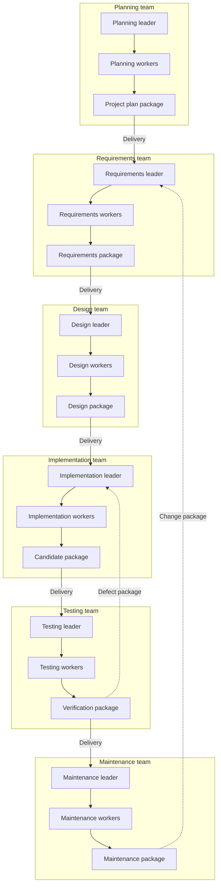

# SDLC Agent Teams — complete implementation guide

**Planning, requirements and design handoff · Version 1.0.0-design · 9 October 2026 KST**

Build an open-source local system in which six distinct SDLC teams use external LLMs, coding assistants and execution tools. This guide is for Codex, Claude Code and human engineers. It contains the full narrative baseline; the accompanying ZIP supplies machine-readable contracts, SQL, configuration, editable diagrams, fixtures and validation tools.

The six teams are Planning, Requirements, Design, Implementation, Testing and Maintenance. Each owns separate agents, sessions, memory and workspaces. Cross-team communication consists only of immutable specifications/artifact handoffs, including feedback. Shared model/account/adapter code is allowed; shared agents or conversations across stages are not.

**Read this as a design to implement, not a completed application.** All `sdlc` commands and provider wrappers are proposed. Fixture examples are not executed target-application tests. The package validation report states the limited checks actually run. Select and verify provider versions and a native-client isolation launcher during implementation.

## Contents

1. Project plan
2. Requirements
3. Architecture and design
4. Six team specifications
5. Backends and DIY connections
6. Execution and recovery
7. Contracts and service interfaces
8. Verification and acceptance
9. Implementation plan

The numbered documents in `docs/` are the editable source of this consolidated file. Wire field names come from `contracts/sdlc.schema.json`, semantics from chapter 7, and behavior from chapter 2. Resolve contradictions explicitly. Start at M0 with fixture/core code; no paid account is needed to begin.

---

<!-- Source: docs/01_PROJECT_PLAN.md -->

# 01. Project plan

## Purpose and project boundary

Build **SDLC Agent Teams**, an open-source local system that helps participants carry a software project through planning, requirements, design, implementation, testing and maintenance. Each stage is a distinct agent team. Teams exchange explicit specifications and supporting artifacts. Participants can review, edit, contribute code, assume a worker task or change a backend.

This package is the planning, requirements and design handoff for that system. The generated applications are separate software projects with separate repositories, tests and release versions. A document generator alone does not satisfy the objective.

Working repository name: `sdlc-agent-teams`. Python import package/CLI: `sdlc`. Package baseline: `1.0.0-design`, dated 9 October 2026, Asia/Seoul. This is a proposed implementation baseline, not evidence of a built application or supervisor sign-off.

## Stakeholders and success

| Stakeholder | Need | Observable success |
|---|---|---|
| Project participant/student | Experience actual engineering decisions and contribute useful work | Can import a brief, inspect handoffs, change a diagram, implement a task, run tests and maintain a release |
| Human engineer | Implement without reconstructing chat history | Contracts, modules, state machines, error behavior and acceptance scenarios are explicit |
| Codex/Claude Code implementer | Continue work after another implementer stops | Versioned design package plus durable implementation status, no hidden chat dependency |
| Supervisor/maintainer | Assess architecture and progress | Traceable requirements, decisions, evidence and open issues |
| Repository contributor | Add a backend/worker/importer/test technique | Small documented interface and fixture-driven contract checks |

Success is a real small application release plus one maintenance revision, with coherent documents and observed tests. The runtime must survive a provider usage-limit pause and a process restart without losing completed work or mixing stage-team context.

## Scope

The first complete release includes all six teams; flexible Markdown/PDF/DOCX input; source-backed research and simulated stakeholder roles; selected editable diagrams; Codex-first repository work with Claude Code and model API/local alternatives; a constrained build/test runner; artifact-only cross-team handoff; participant review/takeover; durable state, pause and resume; and an end-to-end reservation-service example.

Methods follow project needs. A WBS, interview simulation, state diagram, CFG or formal estimation method is selected when useful or requested. Course materials inform available techniques, not mandatory features or stage exit checklists.

Out of initial scope: multi-tenant hosting, billing administration, a custom social/collaboration platform, automatic real-customer recruitment, production publishing without explicit project policy, arbitrary languages/runtimes, formal proof of correctness, unlimited recursive agents and replacing native provider authentication with a universal login.

## Delivery model

Use Python 3.11+, CLI first, SQLite metadata and inspectable files. Use six fixed team namespaces with scoped leaders/workers. Keep the orchestration kernel deterministic. Initial application execution profile: a small Python API service with SQLite and pytest, built/tested in a pinned isolated image. Add other profiles through the same contracts.

Initial developer support: Windows 11 with WSL2/Docker Desktop and Linux; macOS can follow the same CLI/container profile once verified. The project configuration must identify the selected supported environment. Do not claim support for a platform based solely on provider CLI availability. If the chosen isolation profile is unavailable, document generation can continue but repository jobs requiring that profile pause.

One coordinator owns a project; independent within-team workers may run concurrently. Human collaboration occurs through Git contributions and imported/accepted artifacts, rather than requiring a hosted server. Default concurrency is two workers per project, configurable by account/hardware limits. Default delegation depth is leader to workers only.

## Feasibility decisions

| Concern | Decision | Remaining verification |
|---|---|---|
| Repository-aware code work | Wrap existing Codex/Claude Code capabilities instead of rebuilding a coding agent | Test supported native events, isolation, cancellation and auth mode |
| LLM variation | Typed internal contracts and semantic checks, with bounded repair | Representative model quality and schema capability probes |
| Local models | Explicit Brain adapter; coding/search are separate capabilities | Installed model/endpoint compatibility and capacity |
| Missing real customers/experts | Retrieved evidence plus clearly labeled role simulation | Human product decisions and uncertainty remain visible |
| Resource/usage limits | Task checkpoints and normalized pause/resume | Crash-window and partial-edit tests |
| Team context separation | Handoff delivery grants and isolated working context | Negative tests for arbitrary artifact/session/file access |
| Complexity | Small Python modules, finite queues and local files | Avoid optional UI/framework work delaying the full cycle |

No purchased services or measured budget figures are assumed. Provider subscriptions, API billing and local compute costs depend on the chosen profiles. Track known usage, unknown charges and participant-defined limits; never infer zero cost from missing metadata.

## Milestones and gates

| Milestone | Deliverable | Demonstration |
|---|---|---|
| M0 | Package skeleton, domain contracts, fixture engine, six team principals | Schema/examples load; invalid references rejected |
| M1 | Artifact store, publication/delivery grants, team context isolation | Requirements team cannot read unpublished Design drafts or sessions |
| M2 | Durable task graph, attempts, leases, quota pause/resume | Completed sibling task survives quota failure; interrupted writer reconciles |
| M3 | Importers and Planning/Requirements operations | PDF/Markdown input becomes traceable requirements; missing OCR produces actionable pause |
| M4 | Codex and alternative backend adapters, scoped workspaces | Actual repository inspection/edit with correct auth source and events |
| M5 | Design, diagrams and implementation integration | Selected models and bounded code changes form a runnable candidate |
| M6 | Testbench creation, isolated runner and measured reports | Seeded defect produces observed failure, followed by a verified repair |
| M7 | Maintenance, participant takeover, release and full cycle | One complete project plus regression-verified change |
| M8 | DIY connection polish, contributor examples and optional MCP/viewer | Backend/worker replacement without altering the six-team contracts |

M7 is the first complete system. Recovery and separation belong before rich generation features. Dates and person-week estimates should be set by the implementation team after M0/M1 expose the environment and integration work; this design does not invent an empirical schedule.

## Risk register

| Risk | Trigger | Response/owner |
|---|---|---|
| Attractive but inconsistent artifacts | Conflicting requirement/interface/diagram IDs | Domain validation and stage review; owning leader |
| Hidden cross-team context | Shared native session, workspace or global memory | Stop job, revoke context, rerun isolated; runtime/backend owner |
| Provider protocol changes | Unknown terminal event, parameter or error | Preserve diagnostics, pause capability-dependent work; adapter owner |
| Partial code after interruption | Lost terminal result or coordinator | Reconcile process/worktree before replay; recovery owner |
| Simulated market/verification presented as real | Missing provenance or tool evidence | Reject affected claim/gate; requirements/test owner |
| Overbuilt infrastructure | Hosted UI or framework blocks M7 | Return to CLI and contracts; project lead |
| Unsupported isolation on a student's machine | Cannot enforce required read/write boundary | Offer supported profile; pause sensitive operation, not silent downgrade |
| Student work overwritten | Changed integration base or manual diagram edit | CAS revision checks and explicit reconciliation; integration service |

## Participation and governance

Default policy `collaborative` reviews scope, requirements and release decisions; individual safe operations run without repeated approval. `continuous` progresses under preauthorized scope, still pausing for real blockers. Decisions record actor type (`participant` or `policy`) and exact hashes. Models cannot forge participant approval.

Human engineers and coding assistants share an issue/task list and commit history. At each implementation pause, update the repository's implementation status with completed work, branch/commit, verification actually run, blocked items and next actions. Do not treat this design package as already implemented status.

Choose the repository license before public release. Example assets should be authored for distribution; do not bundle private course slides, credentials or student projects by default.

## Completion criteria

The system fulfills the requirement baseline in `02_REQUIREMENTS.md`, passes the applicable scenarios in `08_VERIFICATION_AND_ACCEPTANCE.md`, demonstrates the M7 cycle, and exposes unsupported/live-untested capability honestly. A successful document-generation call, fixture playback or zero-exit coding turn is not the completion criterion.

---

<!-- Source: docs/02_REQUIREMENTS.md -->

# 02. Software requirements specification

## Normative terms and assumptions

MUST denotes a required behavior for the first complete release. SHOULD denotes a default that may be replaced with a documented equivalent. OPTIONAL features cannot silently become prerequisites. Requirement IDs are stable within this design baseline.

The target software is the SDLC orchestration system. Its generated application has its own requirements and tests. This document fixes requirements for the orchestration system; the reservation fixture illustrates its behavior.

The environment is single-project-owner local execution with an optional human reviewer. Account/provider limitations, missing tools and ambiguous documents are normal conditions. The design does not assume that a model produces valid content, an external request executes exactly once or a native session lasts indefinitely.

## Actors and user journeys

Primary actor: participant, who supplies the brief, selects accounts/backends and makes or delegates decisions. Supporting actors: supervisor, human contributor, provider/coding tools, source retrieval services and isolated execution environments. Six stage teams are internal actors with disjoint identity/context, not interchangeable workers.

Core journeys: start/import a project; review and accept scope/requirements/design; request/edit a model; contribute code or take over a task; inspect/run tests; pause/resume after a limit; switch an unfinished task's compatible backend deliberately; and apply a maintenance change with impact analysis.

## Functional requirements

| ID | Requirement | Acceptance condition |
|---|---|---|
| FR-001 | MUST instantiate six distinct team namespaces: planning, requirements, design, implementation, testing and maintenance. | Every agent/task/session has one owning team; a worker is never reassigned across teams. |
| FR-002 | MUST support a leader and bounded specialist workers inside each team. | Persisted acyclic task plan declares role, dependencies, allowed capabilities and outputs; default worker concurrency is two. |
| FR-003 | MUST permit cross-team content access only through published HandoffBundle deliveries. | Receiver can read the exact accepted grant set; unpublished drafts, conversations and unrelated artifacts are inaccessible. |
| FR-004 | MUST retain original project inputs and normalize relevant content from Markdown/text, PDF and DOCX. | Source hash/locations and extraction gaps retained; unavailable OCR yields needs_input rather than empty success. |
| FR-005 | MUST support research and evidence-informed expert/customer role tasks. | Retrieved claims, role simulation and assumptions are distinguishable; no real survey/interview falsely claimed. |
| FR-006 | MUST produce a practical plan covering scope, feasibility, work, assumptions and risks. | Planning handoff contains the agreed minimum records without requiring every lecture technique. |
| FR-007 | MUST produce functional/NFR/rule records with verifiable acceptance conditions. | Stable IDs, evidence links and resolved/blocking ambiguity dispositions exist. |
| FR-008 | MUST produce implementable design decisions, responsibilities, interfaces/data and important behavior. | Accepted requirements map to realizing design elements or explicit unresolved findings. |
| FR-009 | MUST recommend useful diagram types from a specification and support requested additions/revisions. | Selected diagrams have purpose/scope, editable source, rendering/validation and trace references; manual edits preserved. |
| FR-010 | MUST use a CodingBackend for bounded repository work, preferring Codex by default. | Jobs operate on identified isolated snapshots, return events/diffs, and integrate through explicit checks. |
| FR-011 | MUST support Codex, Claude Code and direct/local Brain connection profiles through separate interfaces. | Switching a compatible adapter does not require modifying all stage modules; unsupported features are explicit. |
| FR-012 | MUST allow participant review, manual editing/takeover and submission. | Human contributions enter the same version/validation path, with author provenance and no silent overwrite. |
| FR-013 | MUST plan tests, generate executable testbenches and run them through an ExecutionBackend. | Harness, fixtures, doubles/drivers, setup/teardown, oracles and report collection are inspectable. |
| FR-014 | MUST link observed test results to case IDs and exact code/suite/environment snapshots. | Missing/skipped required cases and simulated runs cannot satisfy release gates. |
| FR-015 | MUST triage maintenance, analyze impact and route rework to owning teams. | Change packages reopen the earliest affected owner and stale dependent outputs; previous releases remain historical. |
| FR-016 | MUST persist task plans, attempts, outputs, workspace/session refs and decisions. | Restart reconstructs completed and unfinished work without relying on chat memory. |
| FR-017 | MUST detect usage/auth/network/output/tool failures and expose appropriate pause/input/error states. | Known quota exhaustion pauses affected account work without repeated calls; reset times are never invented. |
| FR-018 | MUST resume unfinished work after reconciliation. | Completed unchanged results retained, uncertain coding edits inspected, no duplicate writer launched. |
| FR-019 | MUST preserve immutable artifact revisions, hashes and dependency links. | Accepted upstream changes create new revisions and invalidate relevant downstream outputs. |
| FR-020 | MUST separate approval, task completion and execution evidence. | Model text cannot approve a baseline or fabricate measured results. |
| FR-021 | MUST export a selected baseline with manifests, specifications and supporting artifacts. | Export contains the exact selected versions and excludes credentials/private drafts outside scope. |
| FR-022 | MUST provide fixture-mode development and failure replay. | Contract/recovery development needs no paid account; fixture observations are labeled. |
| FR-023 | SHOULD expose the same services through an optional MCP adapter. | Tools cannot bypass delivery grants, gates, errors or checkpoint policies. |
| FR-024 | MUST document effective authentication and usage source for each backend. | Native mode is not silently overridden by inherited API variables; no automatic paid-provider fallback. |

## Nonfunctional requirements and engineering invariants

| ID | Requirement | Verification target |
|---|---|---|
| NFR-001 | Team identity, session context and ungranted payloads MUST remain isolated at the agent context/tool boundary. | Canary artifacts/messages and filesystem attempts across teams denied; same model/account reuse does not merge history. |
| NFR-002 | A reported completed operation MUST have durably recorded output/state. | Crash tests before/after publication and DB commit recover consistently. |
| NFR-003 | Logical-result publication and delivery acceptance MUST be idempotent. | Duplicate requests/events do not create duplicate accepted results or deliveries. External billing exactly-once is not promised. |
| NFR-004 | Concurrent workers MUST not overwrite each other or participant work. | Per-workspace writer lease and expected-base checks; conflicted integration pauses. |
| NFR-005 | All automatic loops MUST be bounded by effective supported limits. | Exhausted attempts/time/budget stop dispatch; unavailable hard native-tool limits are disclosed. |
| NFR-006 | Secrets MUST not appear in artifacts, ordinary logs, exports or generated-code environments. | Canary secret checks and child-environment inspection. |
| NFR-007 | Generated-code execution MUST use the selected constrained environment. | Missing isolation/runtime produces blocked capability; shell=False alone is not sufficient. |
| NFR-008 | Core state/contracts MUST be provider-independent and portable. | Native sessions may expire; fresh sessions resume from durable records. |
| NFR-009 | Code SHOULD be readable, typed at public boundaries and modular. | A new backend/worker/importer uses documented interfaces, not six copied implementations. |
| NFR-010 | Evidence MUST distinguish actual, imported, assumed, model-generated and fixture/simulated content. | Provenance survives rendering, delivery and export. |
| NFR-011 | Status and recovery MUST be understandable without provider-specific expertise. | Pause message names stage/task, saved progress, reason and exact continuation action. |
| NFR-012 | UTF-8 documents and Korean/English content MUST survive import/render/export. | Round-trip fixture preserving text and source references. |

Performance targets are bounded-work requirements rather than fabricated timing claims. The implementation team should measure status/query/import latency on the supported environment and document any target adopted. Provider latency is not under local runtime control. A quota reset time is externally supplied information.

## Cross-team communication rules

Only `participant` ingress and the six team IDs exist as content principals. Kernel/backend services operate on behalf of a scoped principal. A worker cannot select another principal.

Forward flow is Planning → Requirements → Design → Implementation → Testing → Maintenance. The arrow means one immutable artifact delivery. Feedback uses a new defect, clarification or change-request bundle to a named owner. It is not direct conversation or shared memory. Maintenance may reopen any earlier team according to impact.

Every forward bundle declares all artifacts required by the receiver, including earlier specifications explicitly forwarded by the sender. Provenance references alone do not grant content access. The runtime may hold metadata globally but must not inject global conversations or arbitrary artifact contents into team prompts.

## Business and policy rules

BR-001: Default mode is collaborative, with review at scope/requirements/release decisions; safe sub-operations do not need repeated confirmation.

BR-002: Continuous mode records policy decisions as policy decisions, never participant sign-off. Project policy selects which gates need review.

BR-003: A missing hard prerequisite blocks only dependent work; nonblocking uncertainty can proceed as an explicit assumption.

BR-004: Native sessions are scoped to project/cycle/team/task/profile. Reusing account credentials is allowed; reusing another team's conversation/session or global project memory is not.

BR-005: An agent can propose work/content, but only the runtime validates, publishes, delivers, accepts and changes execution state.

BR-006: A failed actual test is a valid observation and routes a defect. It is not a failed provider request to retry until a nicer answer appears.

BR-007: Release evidence must match the exact candidate. Changing a requirement, code snapshot, suite or relevant environment invalidates affected acceptance evidence.

BR-008: Local-model text compatibility does not imply coding, search, tool use or isolation compatibility. Capabilities are separately probed and declared.

## Minimum complete project and exception handling

A project may have short documents and few diagrams. It cannot omit the six responsibilities merely because a model can write code immediately. Required content is determined by project risk/acceptance policy, not a fixed page count. Exceptions record approver type, reason, affected IDs and consequences. An exception cannot relabel a simulated result as measured or bypass an explicitly required isolation boundary.

For a first release, success includes one real application, observed tests, one artifact-routed defect repair, one maintenance revision and one recovered quota interruption. The package's fixture data alone cannot satisfy that application-level release claim.

## Requirements traceability to design

| Requirement group | Design location | Verification location |
|---|---|---|
| FR-001–003, NFR-001 | `03_ARCHITECTURE_AND_DESIGN.md`, delivery contracts | Team identity/grant/session negative scenarios |
| FR-004–009, NFR-010/012 | Team specs, import/diagram service design | Import, research provenance and diagram scenarios |
| FR-010–012/024, NFR-004/006/008 | Backend connections and repository integration | Auth, participant edits, capability/session scenarios |
| FR-013–015/019/020, NFR-007 | Team specs, execution/recovery and contracts | Actual test, rework/stale and maintenance scenarios |
| FR-016–018, NFR-002/003/005/011 | Execution/recovery state machine | Quota, crash-window, duplicate replay and status scenarios |
| FR-021–023, NFR-009 | Service interfaces, implementation plan | Export, fixtures and optional MCP contract scenarios |

The detailed acceptance scenario document supplies test steps. Implementers should retain these IDs in code issues, scenario tests and release evidence.

---

<!-- Source: docs/03_ARCHITECTURE_AND_DESIGN.md -->

# Architecture and detailed design

## 1. Governing structure

The system has **six distinct SDLC teams**. Each team owns a leader, its workers, task history, model sessions and workspaces. A common runtime operates the machinery; it is not a shared conversational leader. The previous generic leader/worker pipeline is an internal team template only and must never be used as the global MAS architecture.



Every edge crossing a team box is a published `HandoffBundle` and recorded `Delivery`, including feedback. The drawing omits runtime routing and participant review for clarity. No edge grants direct agent-to-agent conversation. Other registered routes, such as Requirements to Testing for early test planning, obey exactly the same protocol. A worker type named reviewer can be implemented by reusable code, but its agent instance belongs to exactly one team.

## 2. Layers and dependency direction

Use Python 3.11 or later as the initial orchestration language. This is a design choice for readable teaching code, CLI integration and SQLite support, not a requirement that generated applications use Python. Start with one process and a bounded asynchronous scheduler, then use supervised child processes or containers for tool execution. A distributed queue, vector database and hosted control plane are unnecessary for the first release.

| Layer/module | Responsibility | Must not do |
|---|---|---|
| `cli` | Parse commands, show status, collect explicit decisions, export/import | Implement stage logic or call providers directly |
| `application` | Use cases: import, plan, run, review, resume, publish, deliver | Depend on a specific model SDK |
| `domain` | Typed contracts, state transitions, ownership, route/gate rules | Read credentials or launch commands |
| `runtime` | DAG validation, scheduler, attempts, leases, recovery, quotas | Invent product requirements or cross-team context |
| `teams/<team>` | Operation registry, prompts, required outputs and semantic reviews | Access the database or other teams' files |
| `ports` | Brain, CodingBackend, ResearchBackend, ProcessRunner interfaces | Include vendor response types in domain objects |
| `adapters` | Provider calls, native CLI events, local servers, auth mapping | Decide task completion without runtime validation |
| `artifacts` | Immutable payloads, imports, normalization, manifests, grants | Resolve arbitrary filesystem paths supplied by a model |
| `storage` | SQLite repositories, migrations, outbox, fenced transactions | Expose SQL to workers |
| `verification` | Deterministic schemas, source references, render/build/test evidence | Treat an LLM assessment as command execution evidence |

Dependency direction is adapters/CLI toward application and domain. Team operations depend on ports and domain contracts. Keep provider imports out of team modules. Use small interfaces, explicit request/result classes and dependency injection; avoid an elaborate autonomous-agent framework that obscures control flow.

## 3. Identity and information boundaries

An agent principal contains `project_id`, `cycle_id`, `team_id` and `agent_instance_id`. Bind it at launch from a registered task; model-provided team IDs cannot change this principal. A worker's task lineage can have several attempts and provider sessions, but cannot migrate to another team. Native session identity additionally binds backend profile, authenticated account reference and workspace lineage.

There are two separate stores: a privileged runtime control store and materialized team views. The former may know all project metadata. A model or coding process receives only its permitted view. Never mount the runtime database, project-wide artifact store, unrelated working trees or other teams' native-client history into an agent process.

The authorization rule for cross-team reads is:

1. The target team has an accepted delivery for this project and exact bundle digest.
2. The requested artifact reference occurs in that delivery's explicit `read_grants` and in the sealed bundle manifest.
3. The task declares that accepted delivery and artifact reference.
4. The runtime verifies the bytes against the reference digest before materializing them.

An artifact's `depends_on` entries describe provenance; they do **not** grant access to their contents. A bundle's manifest must explicitly flatten the required input closure. For example, Testing needs the exact requirements, design, candidate source and relevant build instructions; Implementation must explicitly forward the authorized versions in its outgoing manifest. Do not recursively fetch arbitrary provenance references. Missing required content produces a typed missing-input finding and a clarification package.

Forwarding is allowed only when the publisher owns the artifact or has a valid inbound read-and-forward authorization under project policy. Imported confidential material can have an explicit no-forward policy. The runtime checks this before sealing the manifest. Team-local drafts cannot become cross-team inputs until published. A participant may inspect all project outputs, but participant access does not automatically expose those outputs to every agent.

Use OS or container read isolation for compliant execution. A working directory, prompt rule or write-only sandbox is insufficient. The first supported execution profile must pass cross-team canary-read tests for normal file tools, native-client instructions/history and enabled external tools. If the installed profile cannot enforce these boundaries, return `capability_missing` and `needs_input` for the affected operation. A clearly labeled development mode is optional and must not pass the compliant lifecycle gate.

## 4. Artifact model and baselines

An `Artifact` describes one immutable revision and its payload. `ArtifactRef` is the tuple of ID, revision and SHA-256. Readable paths are package-relative labels, not authority. Revision numbers advance only within an artifact ID. Edits create new payloads and records; no in-place edits of published content.

Maintain separate mutable projections for lifecycle state: draft, reviewable, accepted, superseded or stale. Acceptance is a decision about exact revisions, not a property of a filename. A `HandoffBundle` seals an explicit artifact set, provenance, summary, findings and next actions. A `Delivery` binds that bundle to a target team and expected target baseline. Delivery receipt status is independent of engineering gate approval: accepting transport means it was validly received; it does not mean every requirement, test or release passed.

Baselines are runtime records of a team, cycle, accepted bundle digest and decision. `expected_target_baseline` implements compare-and-swap when delivering revisions. A new source baseline invalidates applicability of dependent evidence; it does not erase that evidence. Compute affected nodes from exact input references and semantic trace links, then request review when impact is uncertain. Never assume unchanged file contents imply unchanged requirement semantics.

Use archive payloads for source snapshots and testbench snapshots. Record archive digest and an inner file manifest with relative paths and hashes. Reject absolute paths, traversal, symlinks escaping the extraction root, executable import macros and decompression limits exceeded. The implementation integration workspace is private. Testing has its own immutable source copy plus its test overlay. Maintenance receives the released baseline closure and its evidence.

## 5. Stage leaders and operations

Each leader receives its scoped inbox and proposes a bounded task graph of registered operations. The runtime validates ownership, inputs, schemas, dependency acyclicity, concurrency, budgets and tool capabilities. The leader is responsible for engineering synthesis, while the runtime is responsible for admissibility and durable execution.

Operation names begin with their team ID, such as `requirements.define_acceptance`. The operation registry declares version, input kinds, output schema, required capabilities, permitted write paths and check recipes. Workers cannot invent operation names that become callable functions. Cross-team dependencies must be delivered artifact prerequisites; `Task.depends_on` is restricted to tasks inside the same team.

In a small project, a leader can perform more than one role inside its own team. Start with a maximum of two concurrent workers and no recursive worker spawning. A proposed extra worker or repair attempt consumes the same budget policy as other work. A semantic reviewer can reject poor content; its prose cannot override a failing deterministic contract or missing mandatory evidence.

## 6. Flexible document intake

The importer accepts Markdown/plain text, PDF and DOCX in release one. JSON is useful for normalized internal contracts, not mandatory user input. Store originals, compute hashes, detect type by content and apply configured size/page/archive limits before extraction. Save normalized text, source locations, tables where recoverable, extraction warnings and a completeness assessment. OCR is a declared optional capability; scanned or unreadable content must be surfaced.

Normalize in two steps: deterministic extraction followed by a scoped interpretation task. Preserve source IDs and page/paragraph locations in interpreted claims. Imported JSON receives the same validation as other sources. A PDF is never rejected merely because it is not JSON; an unreadable page can block only conclusions that depend on it. Contradictory source versions produce questions rather than silent precedence guessing.

Treat text inside imported files and websites as evidence, not runtime instructions. Tools, permissions and workflow state come from the operation registry and participant policy. If an imported document says to reveal credentials or read another team's files, retain it as untrusted content and refuse the operation.

## 7. Research and diagrams

Research has a retrieval phase and a synthesis phase. The former saves URL, title, publisher when available, retrieval time, source date when known, relevant excerpts/locators, query and limitations. The latter links claims to those sources and separates inference, assumption and simulated stakeholder opinion. Do not fabricate sources or measured demand. Simulated surveys store their generation method and synthetic responses. Multiple LLM personas are not independent customer samples.

The diagram service is shared code, but requests and outputs belong to the requesting team. A request names permitted source references, diagram type, engineering question and included requirement/component IDs. An agent recommends diagrams with reasons and estimated scope; a student can add another supported diagram or provide its editable source. Reject unsupported syntax/capability with a useful alternative instead of silently returning an unrelated image.

Use Mermaid for supported flow/state/sequence/component-style views and PlantUML where UML notation such as use cases is more suitable. Start with a small installed renderer set and register capabilities. Do not promise that Mermaid natively renders every UML diagram. Store editable source, renderer/version, command evidence and SVG/PNG when rendered. Validate syntax, referenced IDs, meaningful labels and consistency with the specification. A drawing can be a valid draft without a render, but must be labeled unrendered. The renderer runs in the constrained ProcessRunner and cannot retrieve arbitrary remote includes.

## 8. Execution and evidence

The process collector, not the LLM, records command execution. Commands are registered recipes or participant-approved argument arrays; no model-generated shell string is automatically privileged. Separate environment preparation from execution. Target-application builds/tests run without provider credentials and with bounded files, network, process count, time and disk access.

Test evidence ties together source snapshot, testbench snapshot, requirements/acceptance version, environment identity, command recipe, timestamps, exit code, assertion results and log references. A process exit of zero is insufficient when the report contains zero collected tests or contradicts mandatory case coverage. Preserve `not_run`, setup error, assertion failure, timeout and cancellation distinctly. See the Testing team and acceptance plan for release gates.

The handoff package may contain code examples and fixture results, but those are marked `origin: fixture` and cannot satisfy executed-test or release gates. This implementation handoff itself contains no implemented SDLC application and no live-provider validation.

## 9. Participant workflows

The first interface is a CLI with readable Markdown reports. A minimal participant path is: initialize project; configure a backend; run doctor; import brief; plan/run Planning; review exact outputs; proceed through each team; inspect test findings; deliver repairs; accept a local release; open a maintenance request. Each command displays its current team/baseline and whether the next action makes a billable request.

Support collaborative mode with decisions at stage gates and continuous mode with an explicit project policy. Continuous mode records policy decisions as such; it never records a human signature. Students can request diagrams, edit specifications, take over a task, import manual work and select an approved alternate backend. Imports create revisions and invalidate affected work through the same service paths as agent work.

When paused, show the cause, preserved artifacts, uncertain partial effects, reset time only if supplied reliably, and exact resume action. `resume --dry-run` performs no model call. A backend handover rebuilds context from accepted inputs and checkpoints; the new model does not inherit another team's hidden conversation.

## 10. Decisions and tradeoffs

| Decision | Reason | Revisit when |
|---|---|---|
| Six owned teams with artifact transport | Makes responsibilities teachable and handoffs auditable | Never weaken within this project's scope |
| Local CLI, SQLite and immutable files | Small deployable open-source core with durable recovery | Demonstrated multi-host coordination need |
| Provider-neutral ports; Codex default coding | Supports native tooling and model substitution | Adapter capability evidence changes |
| Exact references plus flexible import | Accepts human documents while enforcing machine boundaries | Add an importer without weakening contracts |
| Native client isolation is a release gate | Separate sessions alone do not enforce information boundaries | An OS profile proves equivalent protection |
| Explicit source/test snapshots | Keeps results reproducible across team changes | Optimize storage with safe deduplication |
| MCP as optional thin facade | MCP is a tool protocol, not login or scheduler | Core CLI/service paths are stable |

Open implementation choices are dependency versions, tested native-client versions, renderer distribution and one supported isolation launcher. Resolve them in M0/M1 with recorded spikes before claiming support. They must not alter the accepted interfaces or six-team boundary without a design change record.

---

<!-- Source: docs/04_TEAM_SPECIFICATIONS.md -->

# Six SDLC team specifications

This document defines the behavior of the six distinct engineering teams. It is an implementation contract, not a requirement to reproduce every method in a textbook. Read the repository's architecture, schemas and runtime specification for transport and persistence rules; this document adds domain responsibilities without redefining `Task`, `TaskResult`, `Artifact`, `HandoffBundle`, `Delivery`, `BackendEvent` or `NormalizedError`.

## 1. Common team contract

The stable team IDs are `planning`, `requirements`, `design`, `implementation`, `testing` and `maintenance`. Each team has its own leader and its own workers. A worker role such as reviewer may occur in several teams, but each occurrence is a different agent with a different session, memory namespace and workspace. Bind every leader and worker identity permanently to its owning team; scope worker identities and sessions to the logical task, with attempts recorded separately. Never transfer a leader or worker conversation to another team.

Shared provider accounts, model weights, adapter classes, rendering tools and execution infrastructure are allowed. Shared agent memory and undeclared access to another team's working files are not. Every backend session is bound to one team and one logical task. It may resume across attempts of that same logical task only, after reconciliation; never resume it for a successor task, a different worker task, or another team. A successor task starts a fresh session with explicitly materialized task inputs.

All cross-team information passes through an immutable `HandoffBundle` and a runtime-recorded `Delivery`. Packages include specifications, selected evidence, diagram sources/renders, repository snapshots, executable tests, findings and change requests as applicable. The runtime may forward an accepted Requirements package to Testing for early test planning. That is a delivery, not a conversation between the two leaders. Downstream teams can inspect original materials only when their immutable references are explicitly included in their delivered input set.

The runtime routes packages, materializes allowed inputs, validates dependencies and persists results. It does not pass private reasoning or undocumented verbal advice between teams. A request for clarification becomes a small change/question package addressed to the responsible team; the answer returns in another package. Within a team, its leader can delegate bounded tasks and synthesize worker results.

### Common operation lifecycle

1. `TEAM.intake` inspects delivered artifacts, their revisions and extraction gaps; it proposes an input assessment.
2. `TEAM.plan_work` proposes a bounded task graph using registered operations, explicit dependencies, assigned roles and expected deliverables.
3. The runtime validates and dispatches it. Workers return artifacts and findings to their own leader.
4. `TEAM.review` checks semantic completeness and evidence. Deterministic services separately check schemas, references, hashes and applicable commands.
5. `TEAM.prepare_handoff` proposes the readable specification and artifact manifest. Runtime publication and delivery happen only after the applicable gate decision.

These are logical operation names to register, not permission for a model to invoke arbitrary functions. More specific operations appear below. Each can be used independently when its declared prerequisites hold.

### Input modes and gates

In **provisional mode**, a team can inspect incomplete imports, explore alternatives, draft tests or draw requested diagrams. Outputs retain unresolved assumptions and cannot silently qualify as accepted baseline evidence. In **accepted mode**, tasks pin exact accepted inputs. Accepting an upstream revision causes dependent outputs to be reassessed or marked stale; historical evidence remains intact.

Every handoff identifies its input baseline, artifact revisions, traceability, unresolved findings, assumptions, checks and decision authority. Completing a task is separate from accepting its output. Gate acceptance follows the participant's configured review policy; the model never fabricates human approval. Scope expansion, contradictory mandatory requirements, unknown critical contracts, invalid evidence and unmet required release conditions cannot be hidden by a positive prose summary.

A provider interruption preserves finished artifacts and unfinished work, emits the common normalized pause/error result and returns control to the runtime. Workers must not restart the whole cycle, switch providers silently or guess quota reset times. A useful partial output is retained as a draft, not promoted to a completed handoff.

## 2. Planning team — project direction and feasibility

**Human responsibility:** establish what problem is worth solving, for whom, with what constraints and a feasible development approach. Planning owns project direction, not detailed product requirements or implementation design.

**Agents:** planning leader; market/domain researcher; feasibility analyst; delivery/risk planner; planning reviewer. Small projects may instantiate only the roles needed, while keeping the team boundary intact.

**Inputs:** participant brief, intended users, constraints and success expectations; delivered existing-system snapshots or evidence; maintenance escalation when scope or feasibility changes. A natural-language brief is sufficient to begin provisionally. Missing budget or schedule is an unknown, not an invitation to invent an approved value.

| Operation | Responsibility and concrete result |
|---|---|
| `planning.frame_problem` | State problem, beneficiary, current alternatives, measurable success proposals, included and excluded scope. |
| `planning.research_context` | Retrieve market/domain evidence relevant to decisions; record source dates, claims, limitations and research questions. |
| `planning.assess_feasibility` | Compare technical, data, operating and resource constraints; propose bounded feasibility probes where needed. |
| `planning.plan_delivery` | Identify work packages, dependencies, resources, estimates and milestone evidence. |
| `planning.assess_risks` | Record risk, likelihood/impact rationale, owner, trigger and response; distinguish estimates from measurements. |

**Sequence:** clarify the problem from available evidence; research material uncertainties; propose scope and alternatives; assess feasibility; identify risks and delivery increments; reconcile contradictions and prepare the project plan. A feasibility probe produces observations in a planning-owned workspace. If a coding worker helps the probe, it is a planning worker, not an Implementation agent visiting Planning.

**Research and stakeholder substitution:** a simulated customer or domain expert can challenge the proposed value and operating assumptions after reading a bounded evidence packet. Their statements are labeled role simulation. Actual retrieved claims retain references. Invented interviews, survey counts and unsupported market-size estimates are forbidden. Search unavailability can result in imported evidence or an explicitly provisional assumption; it need not prevent drafting unrelated parts of the plan.

**Diagrams:** recommend a project context map when scope is unclear, a work/dependency graph when sequencing matters, or a schedule view when dates are meaningful. Compute dates and totals from recorded values. Do not generate a Gantt chart simply to fill a document section.

**Minimum outgoing package:** `PROJECT_PLAN.md` containing problem, users, success measures, boundaries, constraints, feasibility, work plan, risks and open decisions; linked research/evidence; accepted and proposed assumptions; selected diagram assets. Requirements receives the original brief as well as the plan so that a summary cannot erase an important constraint.

**Gate and participation:** the participant can choose scope, challenge estimates or author the plan manually. The acceptance gate requires an identifiable problem, scope and feasible path, plus dispositions for material risks. An unresolved resource impossibility blocks dependent commitments. A maintenance request that changes only code behavior without changing scope should not trigger a new Planning cycle.

## 3. Requirements team — observable product commitments

**Human responsibility:** transform goals into consistent, testable functional requirements, nonfunctional requirements, domain rules and acceptance conditions. It owns intended behavior; it does not infer requirements solely from existing code.

**Agents:** requirements leader; domain/customer-role researcher; requirements analyst; scenario/model author; requirements reviewer. Simulated expert roles are task-specific workers in this team.

**Inputs:** delivered Planning baseline, original brief and research, imported specifications, participant statements and any requirement-level change package. Provisional input supports exploration; acceptance requires resolution of conflicts affecting the proposed baseline.

| Operation | Responsibility and concrete result |
|---|---|
| `requirements.investigate_needs` | Identify actor goals, domain questions and evidence-backed simulated customer/expert objections. |
| `requirements.extract` | Produce stable requirements/rule IDs, statements, rationale, provenance and priorities from supplied materials. |
| `requirements.define_acceptance` | Specify observable expected outcomes and measurement conditions, including negative and failure behavior. |
| `requirements.model_scenarios` | Describe normal, alternate and failure flows; propose diagrams for the questions these flows raise. |
| `requirements.resolve_conflicts` | Present incompatible requests, scope tradeoffs and proposed decisions; retain disagreement until disposition. |
| `requirements.validate` | Detect ambiguity, contradiction, missing acceptance or source links, and untestable mandatory requirements. |

**Sequence:** identify stakeholders and unanswered questions; retrieve sources; conduct bounded role simulation; normalize proposed requirements; derive scenarios and acceptance; review consistency, priority and feasibility; establish the proposed requirements baseline. Web research informs product choices but does not independently authorize them. An LLM customer preference is a hypothesis until adopted as a participant decision or documented assumption.

If a student requests a mock survey, save the questionnaire, persona assumptions, synthetic raw responses and reproducible analysis. Label every result synthetic. A percentage of generated responses is not measured customer demand. Formal Delphi-like rounds are optional and do not gain evidential independence merely by using multiple models.

**Requirement quality:** each accepted requirement has an ID and revision, statement, kind, rationale/source, priority and acceptance conditions. Nonfunctional requirements name a metric, threshold, workload/environment and verification method where applicable. Unknown latency targets become decision questions, not fabricated commitments. Accessibility/usability requirements can use inspection or participant evaluation where automated measurement is inadequate.

**Diagrams:** recommend use cases for external actor goals and system boundaries; activity views for business workflows; state views for important lifecycle rules. A use-case drawing complements, rather than replaces, textual scenarios and nonfunctional requirements. Student requests such as “add cancellation failure paths from this PDF” must preserve source locations and flag unspecified policies.

**Minimum outgoing package:** `REQUIREMENTS.md` with scope, glossary, actors, functional/nonfunctional requirements, rules, acceptance and unresolved dispositions; canonical requirement records; selected scenarios/diagrams; evidence and decision references. Design and, when early testing is enabled, Testing receive separately recorded deliveries of the same immutable baseline.

**Gate and backflow:** accepted scope items must be testable and internally consistent. Material contradictions or missing required business decisions block affected commitments. New scope beyond the project plan is packaged to Planning. Design/Test questions return here as packages; clarification creates a revision with impact references rather than a hidden instruction to the other team.

## 4. Design team — implementable engineering decisions

**Human responsibility:** define architecture, interfaces, data, behavior and operating assumptions that realize the accepted requirements. Provide enough detail for another engineer to implement without inventing critical contracts.

**Agents:** design leader; architecture/options analyst; interface/data designer; interaction designer; repository/spike worker; design reviewer. Use a configured Codex coding backend by default for repository inspection and feasibility spikes; Claude Code or a local adapter can satisfy the same bounded job contract.

**Inputs:** delivered SRS and provenance, project constraints, accepted change scope, versioned existing code where relevant. A provisional design may compare options before all requirements are accepted, but cannot conceal those dependencies when handed to Implementation.

| Operation | Responsibility and concrete result |
|---|---|
| `design.inspect_system` | Describe existing interfaces, dependencies and conventions with exact snapshot references. |
| `design.compare_options` | Evaluate plausible structures/stacks against the actual constraints; issue decision records with rejected alternatives. |
| `design.define_architecture` | Allocate responsibilities, module boundaries, dependencies, deployment assumptions and NFR mechanisms. |
| `design.define_contracts` | Define APIs/messages, data constraints, invariants, errors, compatibility and migration rules. |
| `design.define_behavior` | Specify state transitions, important interactions, UI/CLI workflows and failure/recovery behavior. |
| `design.probe_feasibility` | Run a bounded prototype in a design workspace and report observed results and limitations. |
| `design.plan_implementation` | Decompose approved design into independently reviewable tasks with inputs, boundaries and validation obligations. |

**Sequence:** map accepted requirements to design obligations; inspect the existing system when supplied; select a supported approach; define module and data contracts; model consequential behavior; test uncertain assumptions with bounded spikes; review consistency and hand off implementation tasks. Exploratory code is labeled as such, with a base revision and observed commands. It becomes production code only through the later Implementation process.

**Diagrams:** choose component/dependency views for responsibility boundaries; sequence diagrams for ordering/errors; state diagrams for lifecycle invariants; ERD for persistence; class/object views for useful object models; deployment views for runtime placement. DFDs are appropriate when data transformation and trust boundaries need clarification. Explain the question each selected diagram answers. Rendering validates syntax; reviewers must additionally check references and meaning against contracts.

**Minimum outgoing package:** `DESIGN.md` with architecture, decisions, module responsibilities, interfaces, data, key behavior, operational/error handling, NFR realization and requirement mapping; interface/schema sources where applicable; selected diagram sources and renders; implementation task decomposition; spike evidence and known limitations. Define what each task can change and how it will be checked.

**Gate and participation:** all mandatory requirements need design coverage or a reasoned disposition. Critical interfaces and invariants must be concrete; conflicting diagrams/contracts block affected tasks. Students can select alternatives or modify diagrams; the team reconciles these edits before acceptance. An apparently infeasible requirement returns to Requirements as a change proposal. Design may not quietly weaken it or label a missing requirement “implementation detail.”

## 5. Implementation team — integrated, runnable candidate

**Human responsibility:** implement the accepted design, create developer tests, review changes and deliver a reproducible candidate. It owns source changes, not permission to rewrite the requirements.

**Agents:** implementation leader; bounded coding workers; developer-test worker; code reviewer; single logical integrator. Codex is the preferred coding adapter, not a hard dependency. Each coding session and worktree belongs to this team and one logical task. Session resume is permitted only across attempts of that task; a successor task starts a fresh session.

**Inputs:** delivered design, pinned requirements, task scope and source snapshot; executable prototype assets only if explicitly delivered; bug/change packages. Accepted mode authorizes scoped production implementation. Provisional work remains a draft candidate.

| Operation | Responsibility and concrete result |
|---|---|
| `implementation.plan_changes` | Resolve task dependencies, file ownership, interface prerequisites and check recipes. |
| `implementation.prepare_workspace` | Materialize exact inputs in isolated task workspaces with recorded base snapshots. |
| `implementation.code` | Apply one bounded change and emit candidate patches/snapshots with a work summary. |
| `implementation.developer_tests` | Implement unit/contract tests against specified behavior, including relevant failures. |
| `implementation.check` | Run registered build, lint/type and developer-test recipes; collect actual evidence. |
| `implementation.review_changes` | Evaluate scope, correctness, readability, maintainability and test adequacy from the diff and contracts. |
| `implementation.integrate` | Serialize accepted changes, detect stale bases/conflicts and rerun applicable integration checks. |

**Sequence:** plan changes; establish a runnable skeleton where useful; perform bounded coding and tests; review; integrate in dependency order; check the integrated candidate; document installation, configuration and limitations. Workers do not overwrite each other's directories. A stale patch requires reconciliation against the actual integration base. Participant changes follow the same snapshot/diff checks.

The runtime validates tool permissions. Generated application processes run without the coding agent's provider credentials. A coding agent's claim that it ran tests is insufficient: preserve execution collector records. Partial changes after quota exhaustion remain in their task workspace and must be reconciled before retry or provider handover.

**Diagrams:** maintain an as-built dependency or interaction view only when it helps understand the implementation. Differences from accepted design become explicit drift findings; updating a drawing is not authorization to alter the contract.

**Minimum outgoing package:** `IMPLEMENTATION.md` with exact candidate snapshot, build/run/dependency instructions, requirement implementation status, developer verification and known issues; source and lock/configuration files; developer-test assets and collected reports; reviewed change references. Include the original requirement/design versions needed by Testing, not only a developer-written summary.

**Gate and backflow:** a candidate must be reconstructable and correctly labeled. A diagnostic delivery to Testing may intentionally contain a failing build, but does not qualify as a release-ready candidate. Missing prerequisites, unauthorized contract changes or unresolved merge conflicts block affected integration. Ambiguous behavior returns to Design or Requirements through a documented package. Implementation does not negotiate directly with their workers.

## 6. Testing team — executable verification and release evidence

**Human responsibility:** independently evaluate the candidate against requirements and risks, construct a runnable testbench, report observed outcomes and make a release recommendation.

**Agents:** testing leader; test analyst; testbench developer; execution analyst; independent test/release reviewer. A testbench coding job is owned by Testing. It does not become an Implementation worker and cannot silently modify the production source under test.

**Inputs:** delivered SRS/acceptance rules, design, candidate snapshot, relevant developer evidence and environment profile. Early planning needs only a delivered requirements baseline; execution additionally requires an exact source candidate and runnable bench.

| Operation | Responsibility and concrete result |
|---|---|
| `testing.plan` | Choose levels, risks, techniques, environments, coverage obligations and exit criteria. |
| `testing.derive_cases` | Define IDs, source requirements, fixtures/inputs, expected outcomes, cleanup and oracle rationale. |
| `testing.design_bench` | Specify harness, drivers/stubs, state reset, instrumentation, environment, timeout and report recipes. |
| `testing.implement_bench` | Create executable tests and controlled fixtures/doubles in a testing-owned workspace. |
| `testing.preflight` | Collect tests; validate test-node-to-case mapping, dependencies, readiness and safe cleanup. |
| `testing.execute` | Invoke the execution backend against immutable source/suite inputs and collect raw/structured observations. |
| `testing.analyze` | Classify failures, defects, missing evidence and residual risk with links to actual observations. |
| `testing.assess_release` | Compare measured evidence with exit criteria and produce a recommendation for the exact candidate. |

**Sequence:** derive tests from requirements before relying on the implementation; select risk-relevant techniques; implement the bench; preflight collection; execute; investigate failures; issue defect packages; execute the required regression scope on delivered corrected candidates; assess release. Testing may reproduce a suspected fix in an exploratory workspace, but only an Implementation-owned delivered revision becomes the new production candidate.

**Testbench minimum:** system-under-test entry point; dependencies/environment; setup/readiness/reset/teardown; test inputs and fixtures; assertions or explicit evaluation rubric; controlled doubles and their limitations; timeout/resource bounds; seed where relevant; machine-readable results and raw logs. Map collected runner-node IDs to test cases and requirement/oracle revisions. Example: a reservation bench resets a test database, creates a capacity-one resource, submits competing booking requests and checks that the accepted capacity invariant holds; it must not merely assert that the API returned some response.

**Techniques and diagrams:** boundary partitions for limits, decision tables for rule combinations, state transition coverage for lifecycles, sequence views for integration failures and CFG views for code-driven structural coverage. Recommend the subset that answers current risks. Do not label line/branch measurement as complete path or condition coverage. A student can add a specific technique or test case through the same operation registry.

**Result truth and gate:** execution records identify source, suite, fixtures, environment, recipe, timestamps, exit status, counts and reports. Zero tests collected, skipped required cases, interrupted execution and unavailable environments are not passes. Synthetic runs and LLM-predicted outcomes never satisfy observed release criteria. A flaky rerun retains the earlier failure and reports instability. Bench defects are distinguished from product defects; uncertainty remains visible.

**Minimum outgoing package:** `TEST_REPORT.md`, test plan/cases, executable bench, exact tested candidate reference, collected evidence, defect dispositions, known limitations, release recommendation and deployment/rollback requirements. Participant usability evaluations can add actual evidence; role simulation remains labeled. Release acceptance belongs to the configured authority and runtime gate, not an optimistic testing narrative.

## 7. Maintenance team — controlled change and preserved history

**Human responsibility:** understand defects or evolving needs, assess impact, route changes to their owning teams and verify that a new release has adequate evidence. Maintenance coordinates the next cycle; it does not absorb the other five teams.

**Agents:** maintenance leader; incident/reproduction analyst; impact analyst; change/release planner; maintenance reviewer.

**Inputs:** delivered release baseline and test evidence, runtime observations, participant change requests, dependency/environment change evidence and historical accepted bundles. Imported bug reports can be incomplete and still begin triage provisionally.

| Operation | Responsibility and concrete result |
|---|---|
| `maintenance.triage` | Identify affected release, symptom/request, urgency, evidence and corrective/adaptive/perfective/preventive motivation. |
| `maintenance.reproduce` | Attempt a bounded reproduction against the exact release and retain observed results or uncertainty. |
| `maintenance.analyze_impact` | Trace affected requirements, contracts, source, tests, dependencies and operating assumptions. |
| `maintenance.propose_change` | Define scope, alternatives, risks, acceptance, regression obligations and migration/rollback concerns. |
| `maintenance.route_rework` | Prepare a package for the earliest affected owning team and enumerate downstream revalidation needs. |
| `maintenance.verify_closure` | Reconcile delivered revisions and testing evidence with the original request; prepare release notes and baseline proposal. |

**Routing decisions:** unchanged requirements/design with an implementation bug return to Implementation; an architectural/interface defect returns to Design; a changed business rule returns to Requirements; changed feasibility or project scope returns to Planning. Every return is a new explicit delivery. Unaffected accepted artifacts may be reused only with recorded impact rationale; their tests remain evidence about their original snapshots until rerun or justified otherwise.

**Sequence:** intake; reproduce or qualify uncertainty; recover missing context from delivered snapshots; analyze impact; propose/route the change; track runtime delivery status; inspect returned baseline and test packages; check migration/rollback when applicable; propose closure. Reverse-engineered intent must be labeled inferred rather than recovered fact. Maintenance does not instruct another team's coding session or merge its own invisible emergency patch.

**Diagrams:** an impact/dependency graph is useful for cross-cutting changes; before/after state or sequence diagrams explain behavior changes; as-built models can support undocumented legacy systems. Each view pins the old/new revisions it describes.

**Minimum outgoing package:** `CHANGE_SPEC.md` with motivation, reproduction, impact, earliest affected stage, proposed scope, acceptance and regression/migration obligations; after downstream completion, `MAINTENANCE_REPORT.md` with delivered revisions, observed verification, release notes and closure disposition. Preserve the former release and its evidence. A failure to reproduce yields a qualified finding and next investigation action, not a claim that the issue is fixed.

## 8. Student additions and minimum document structure

Every team exposes diagram requests through its own leader. `TEAM.request_diagram` records purpose, requested notation, scope and input revisions, then uses shared rendering infrastructure in the owning team's workspace. Recommend a useful subset; let participants add, replace or decline optional views. Retain editable source, render, reference mapping and validation. Unsupported notation returns a capability finding and an honest alternative; an invented lookalike is not a compliant result. Manual edits create revisions and require reconciliation before regeneration.

Readable deliverables may be one short Markdown document or several documents according to project size. Each needs: purpose/scope; exact inputs; decisions and substantive output; traceability/evidence; selected diagrams or an explanation that none is needed; unresolved issues and assumptions; checks and handoff disposition. The different team-specific contents above remain mandatory. Avoid blank ceremonial sections and exhaustive method inventories.

A participant may take over a task, supply a PDF, alter a diagram or implement a test manually. Normalize the submission, retain its original bytes/provenance, validate the relevant contract and return it to its owning team. Accept useful partial inputs without falsely declaring completeness. The goal is understandable engineering participation with explicit responsibility and reproducible evidence.

---

<!-- Source: docs/05_BACKENDS_AND_CONNECTIONS.md -->

# 05 — Backends, accounts and DIY connections

Status: implementation design, 9 October 2026 KST. Package: `sdlc` in repository `sdlc-agent-teams`. The connection interfaces below are requirements to implement, not working adapters or live-tested credentials. Provider documentation was checked for this handoff; pin and record the versions actually tested by the implementer.

## 1. Connection boundary

The six principals are exactly `planning`, `requirements`, `design`, `implementation`, `testing`, and `maintenance`. Each has distinct leader/worker sessions and workspaces. Reusing adapter code, a provider account, or model weights does **not** permit sharing conversational history or mutable project context.

Cross-team engineering information enters only through an immutable, versioned `HandoffBundle` and its authorized `Delivery`. The adapter receives only the task-local context materialized from those deliveries and same-team work. It cannot search another team's files, memory, sessions, vector index, or Git worktree. A handoff may include source code and evidence alongside specifications.

| Port | Responsibility | Initial implementations |
|---|---|---|
| `Brain` | Produce a typed proposal from an explicit context packet | Codex read-only bridge; OpenAI Responses; Anthropic Messages; local compatible endpoint; fixture |
| `CodingBackend` | Inspect or modify the task's repository snapshot | Codex CLI first; Claude Code CLI alternative |
| `ResearchBackend` | Retrieve evidence and provenance | Configured native search; provider web search; imported evidence |
| `ProcessRunner` | Run declared build/test recipes and capture observations | Isolated execution runner specified elsewhere in this package |

Changing a model endpoint does not provide repository tools, web access, or execution isolation. Keep these ports separate. MCP exposes application operations to a host; it does not replace these adapters or grant generic access to a student's subscription.

## 2. Public adapter contracts

All adapters use the canonical schemas in this package: `Task`, `TaskResult`, `Artifact`, `HandoffBundle`, `Delivery`, `BackendEvent`, and `NormalizedError`. Do not create provider-specific replacements for these records.

The following signatures describe responsibilities; helper request types are internal implementation details, not additional persisted contracts:

| Method | Required behavior |
|---|---|
| `describe()` | Report adapter/version, capabilities and enforcement limits without contacting the provider |
| `probe(live=False)` | Check installation/configuration; only `live=True` may invoke a model |
| `Brain.generate(request: BrainRequest)` | Return a candidate payload plus provider metadata; never commit task completion |
| `CodingBackend.start(job)` / `resume(job, checkpoint)` | Yield `BackendEvent` records incrementally |
| `CodingBackend.cancel(attempt_id)` | Stop the identified attempt; preserve partial outputs and report reconciliation needs |
| `ResearchBackend.retrieve(request: ResearchRequest)` | Return retrieved evidence, retrieval failures and limitations |
| `ProcessRunner.execute(request: ExecutionRequest)` | Return captured execution observations; no model-authenticated environment |

The runtime supplies principal, task/attempt identity, deadline, input hashes, output schema, capability requirements and effective permissions. The runtime validates outputs, registers `Artifact` records, constructs `TaskResult`, and owns state changes. Provider text cannot authorize itself or declare acceptance.

Every adapter declares capabilities individually: schema-constrained output, streaming, native resume, interrupt, repository reading/writing, research, usage events, permission mediation, and enforceable call/token limits. Use `supported`, `unsupported`, or `unknown` plus the probe/version evidence. An endpoint's compatibility claim is insufficient proof.

## 3. Presets and configuration

Provide these inspectable presets:

| Preset | Leaders/content workers | Repository workers | Research |
|---|---|---|---|
| `codex-native` | Codex read-only structured bridge | Codex | Configured, probed native search or imported evidence |
| `api-and-codex` | OpenAI or Anthropic API | Codex | Independently configured |
| `claude-code` | CLI bridge or direct API | Claude Code | Independently configured |
| `local` | Compatible local endpoint | Explicitly selected coding adapter | Separate search or imported evidence |
| `fixture` | Deterministic recorded outputs | Recorded proposals | Recorded/imported evidence |

`codex-native` is the preferred user experience once its launcher passes the isolation/authentication acceptance checks; `fixture` is the default for automated CI. A native profile without a verified launcher is capability-blocked, not ready for autonomous team tasks. Direct/local Brain adapters remain first-class contributions. No silent paid-provider fallback is permitted.

Configuration must include: adapter ID, executable or base URL, model ID, authentication mode, credential reference, time/output limits, permission profile and team/role bindings. Store environment-variable names or credential-store references, never secret values. Model identifiers are selected during setup and pinned in the resolved run configuration; do not assume every account has the same models.

Also configure a nonsecret account binding, `quota_scope_id`, and optional `expected_account_id`/workspace identifier. Compare expected identity with supported native status output before dispatch and on resume. A mismatch yields `needs_input` and zero model invocations. When the backend cannot expose identity, record `identity_unverified`; proceed only under a declared policy or explicit participant selection that accepts this uncertainty. Never label an unverified account as verified. These are connection metadata, not new `NormalizedError` categories.

`sdlc connection add` explains the selected billing source and writes a reviewable configuration. `sdlc doctor` performs local checks. `sdlc doctor --live` makes a small, explicit account/server request and records supported features. Implement installation instructions separately for supported operating systems; these commands belong to the proposed repository until implemented.

## 4. Codex connection: preferred implementation

Install the official CLI using its current platform instructions. In the selected isolated launcher environment, the participant runs:

```text
codex --version
codex login
codex login status
```

Codex documents ChatGPT sign-in and API-key access as separate modes. Native sign-in remains with the official client. For API-key login, the documented `codex login --with-api-key` takes the key through stdin. Never ask a student to paste credentials into a project file. An API key bills the API account; it is not a conversion of subscription allowance. [S1]

For the initial subprocess adapter, construct an argv array equivalent to:

```text
codex exec --json --sandbox read-only --output-schema RESULT_SCHEMA_PATH -
```

Use `workspace-write` for authorized coding tasks. Pass the complete prompt through stdin and set `cwd` to the isolated task repository. Codex documents JSONL events, schema output and explicit `codex exec resume SESSION_ID`. Use the persisted session identifier; never a global “last session” shortcut. The CLI normally requires a Git repository, which the materializer should create. [S2]

The Brain bridge receives a proposal schema and read-only inputs. The coding bridge receives bounded change instructions and returns proposal/evidence metadata. Parse terminal errors as well as exit status. A zero exit status or final assistant message cannot independently complete the `Task`.

A later app-server adapter can use initialization, `thread/start`, `turn/start`, `thread/resume`, and `turn/interrupt`, matching requests to stored thread/turn IDs. Its richer lifecycle can improve permissions and cancellation; it must implement the same contracts. Never fork an upstream team's conversation to create a downstream team. [S3]

## 5. Claude Code connection

Install the official CLI, inspect `claude --version`, and use its native account flow inside the selected isolated launcher environment. Current CLI documentation includes `claude auth login` and `claude auth status`; an adapter must check the installed version before assuming flag availability. [S4]

Documented invocation patterns include:

```text
claude -p "Process the supplied task context." --output-format stream-json --verbose
claude -p "Return the proposed result." --output-format json --json-schema SCHEMA_JSON
claude -p "Continue this task." --resume SESSION_ID
```

The real wrapper passes each argument separately, sends context via the supported stdin mechanism, and extracts structured output from the provider wrapper rather than parsing the whole wrapper as the application result. Test the chosen schema/stream combination against the pinned CLI. [S5]

Configure tool availability and automatic approval separately: an automatic-approval list is not necessarily a tool whitelist. Do not use permission-bypass flags as the default. Unsupported permission requirements pause the task. [S4]

Keep individual local CLI use distinct from embedding an authenticated service. Anthropic's Agent SDK overview instructs third-party developers to use API-key authentication unless offering Claude account login has been approved. This repository must not implement its own Claude OAuth, extract native tokens, or promise that every Claude plan supplies generic API access. Native client authentication and embedded SDK/API mode are separate connection options. [S6]

## 6. Direct API Brains

Use official SDKs with explicit timeouts and `max_retries=0`; the runtime owns retries and their budgets. Construct fresh requests from the authorized context packet. Server conversation IDs, where used, are scoped to the same task/team.

| Adapter | Credential source | API shape to implement |
|---|---|---|
| OpenAI | `OPENAI_API_KEY` reference | `client.responses.create(model=..., input=..., text={"format": {"type": "json_schema", "name": ..., "strict": True, "schema": ...}}, max_output_tokens=...)` |
| Anthropic | `ANTHROPIC_API_KEY` reference | `client.messages.create(model=..., system=..., messages=..., max_tokens=..., output_config={"format": {"type": "json_schema", "schema": ...}})` |

The OpenAI Responses structured-output field is `text.format`. Treat refusal and incomplete output separately from valid parsed data. [S7] Anthropic's current raw Messages field is `output_config.format`; avoid copying the older `output_format` raw-request field. Its documentation also identifies a citations/strict-JSON incompatibility, so retrieval and typed synthesis should be separate calls when needed. [S8]

Project schemas can be richer than provider-supported JSON Schema subsets. Generate a supported transport projection, then validate the returned object against the full application schema and domain rules. Missing capabilities must not silently weaken gates. Preserve rejected candidates and report bounded repair attempts.

## 7. DIY local models

1. Install a local server and a model suitable for available RAM/VRAM.
2. Start the server and obtain its actual model identifier and endpoint.
3. Configure the compatible Brain adapter, URL, model and credential reference.
4. Probe a small structured response, truncation behavior and any required tools.
5. Run fixture-based adapter tests, then a small live task before a full SDLC cycle.

Ollama documents an OpenAI-compatible base URL such as `http://localhost:11434/v1/`; its compatibility example uses an ignored placeholder key. Select the wire API explicitly and test that server/model combination rather than assuming all OpenAI features work. [S9] LM Studio's documented example uses `http://localhost:1234/v1`; obtain the loaded model ID from the local server. [S10] When LM Studio authentication is enabled, configure its actual API token; a dummy key then does not suffice. [S11]

Prefer Chat Completions compatibility for the initial local Brain where verified. Supporting a Responses endpoint is a separate capability. For an unauthenticated loopback server, label any SDK-required placeholder as nonsecret. For a remote lab server use its configured authentication; never forward a cloud-provider secret to an arbitrary custom URL.

A local Brain does not become a CodingBackend. Supply a tested local coding agent or separately configure a supported coding client/provider route and verify editing, tool, session and isolation behavior. Otherwise repository tasks pause as `capability_missing`; students can complete them manually. Model OOM or server unavailability preserves the task and suggests a smaller model, smaller context or restored server.

## 8. Evidence and research adapters

Provider-native web search is optional: OpenAI documents a Responses web-search tool and Anthropic documents its web-search tool separately. Configure supported model/tool versions and record actual tool results, source URLs and retrieved spans. [S12, S13]

Return evidence artifacts with query, retrieval time, source locator, claim supported, origin and limitations. A model remembering a URL is not retrieval. Imported evidence is a valid alternative. Role-play remains labeled synthetic; successful search does not turn generated customer opinions into measurements.

## 9. Process, isolation and recovery requirements

The session ownership key is exactly project/cycle/team/logical-task/profile/account-binding/workspace-lineage. Pin the profile's resolved backend configuration hash; record worker and attempt IDs in associated invocation records. Resume may reuse a native handle only across attempts of the **same logical task** with the full ownership key unchanged and the workspace reconciled. A successor task, including a rerun of a terminal task, starts a fresh session. Changed provider, account binding or profile also requires a fresh session. Only the runtime resolves handles; reject mismatched ownership before contacting the backend. Rebuild fresh sessions from durable allowed inputs, outputs and reconciled partial work, never from another backend's private transcript.

The ProcessRunner must drain stdout/stderr concurrently, bound event sizes, preserve ordered diagnostic references, enforce deadlines, stop the process tree, and hold a single-writer lease. Use argv with `shell=False`; this alone is not isolation. Persist start intent before dispatch. On uncertain interruption, reconcile the process and filesystem before retrying; remote requests may already have consumed usage.

Restrict filesystem access to delivered inputs, this team's task workspace and necessary tools. Separate or disable cross-project memory, automatic session discovery, unreviewed plugins and broad MCP connections. Inspect effective instruction/configuration sources. Sharing an account is allowed, but the credential mechanism must not expose sibling teams' transcripts or mutable state. If a CLI/profile cannot enforce this boundary, return `capability_missing` and require a controlled runner/profile. Do not claim isolation from merely changing `cwd`.

Before enabling native support, run a launcher spike covering official login/status, same-task resume, cross-team file/session/memory canaries and secret isolation from generated-code execution. Record the OS/container image, CLI version and effective settings. One candidate is official login inside a scoped container profile with runtime-controlled persistent client state; its viability is unverified until the spike passes. Another is a supported brokered credential route. Do not parse or copy arbitrary native auth files, mount the host home/session store into every team, or invent a token-extraction workaround. A failed/unavailable spike leaves the native profile capability-blocked and offers a verified profile or manual work.

Build/test execution receives neither provider credentials nor native session stores. Construct child environments explicitly; inherited API variables must not silently override a chosen native account or billing mode. Inspect supported authentication status without reading/copying native credential files. Exported diagnostics redact secrets; usage/cost fields may remain unknown.

## 10. Failure normalization and acceptance

Preserve original status/code, sanitized message, retry/reset metadata, request/session IDs and partial-output references in the canonical records. The following is routing policy, not a new error schema:

| `NormalizedError` category | Runtime response |
|---|---|
| `rate_limited` | Bounded `retry_wait` with provider delay/jitter; then `paused` |
| `quota_exhausted` | `paused`; preserve completed work; show reset only if supplied |
| `auth_required` | `paused`; explain the native-login or credential action |
| `provider_unavailable` | Bounded retry when replay is safe; otherwise reconcile/pause |
| `invalid_output` | Preserve candidate; bounded repair; then `needs_input` or `failed` |
| `context_limit` | Reduce context with preserved provenance; otherwise `needs_input` |
| `permission_required` | `needs_input`; show requested operation and scope |
| `capability_missing` | `needs_input`; explain adapter/manual alternatives |
| `cancelled` | `cancelled` for deliberate cancellation; checkpoint partial work |
| `unknown` | Preserve diagnostics; avoid blind coding replay; `paused` |

HTTP 429 alone does not distinguish temporary throttling from exhausted credit. A missing terminal event is not completion: record `interrupted`, reconcile, then resume safely. Only runtime validation can set `completed`.

Circuit breakers use nonsecret `quota_scope_id`, independent of team context. Derive or configure its account/organization/endpoint/model scope only where provider evidence supports those limits; broad account quota must not be partitioned into model scopes. Configuration aliases using the same account limit explicitly share a scope. When scope/identity is unknown, do not infer independent allowance: retain the known pause, flag unresolved alias relationships and require a configured resolution before dispatching a potentially equivalent connection. Never rotate profiles/accounts automatically to evade a quota pause. A participant may deliberately select an independently authorized alternative; preserve the original pause and start a fresh attempt/session with new provenance.

Required adapter acceptance fixtures: malformed/truncated JSON, refusal, authentication failure, rate versus quota failure, session mismatch, partial coding edits, stream loss, process crash, unknown cost, unavailable local model and attempted cross-team file/session access. Demonstrate one successful live connection per supported adapter/version separately; fixture success is not live verification.

## Sources

These links establish provider capabilities; isolation, contracts and routing above are this project's design decisions.

- S1: [Codex authentication](https://developers.openai.com/codex/auth)
- S2: [Codex non-interactive mode](https://developers.openai.com/codex/noninteractive)
- S3: [Codex app-server](https://developers.openai.com/codex/app-server)
- S4: [Claude Code CLI reference](https://code.claude.com/docs/en/cli-reference)
- S5: [Claude Code programmatic use](https://code.claude.com/docs/en/headless)
- S6: [Claude Agent SDK overview](https://code.claude.com/docs/en/agent-sdk/overview)
- S7: [OpenAI structured outputs](https://developers.openai.com/api/docs/guides/structured-outputs)
- S8: [Anthropic structured outputs](https://platform.claude.com/docs/en/build-with-claude/structured-outputs)
- S9: [Ollama OpenAI compatibility](https://docs.ollama.com/api/openai-compatibility)
- S10: [LM Studio OpenAI compatibility](https://lmstudio.ai/docs/developer/openai-compat)
- S11: [LM Studio authentication](https://lmstudio.ai/docs/developer/core/authentication)
- S12: [OpenAI web search](https://developers.openai.com/api/docs/guides/tools-web-search)
- S13: [Anthropic web search](https://platform.claude.com/docs/en/agents-and-tools/tool-use/web-search-tool)

---

<!-- Source: docs/06_EXECUTION_AND_RECOVERY.md -->

# Durable execution, interruption and recovery

This document specifies runtime behavior for the six isolated SDLC teams: `planning`, `requirements`, `design`, `implementation`, `testing`, and `maintenance`. It is an implementation contract, not evidence that the runtime already exists. The schema files are authoritative for wire-property names; algorithm names below describe behavior. Provider-specific authentication and process protocols belong in the integration design.

## 1. Execution boundary

The runtime is a deterministic coordinator, not a seventh conversational agent. It validates task graphs, grants capabilities, starts adapters, records events and routes published packages. A stage leader may propose tasks and synthesize results; it cannot bypass dependency checks, alter committed evidence, or write another team's state.

Each team has its own agent identities, conversations, memory, credentials references, inbox projection and repository snapshots. Workers may collaborate inside their team. Cross-team input consists exclusively of a validated immutable `HandoffBundle` carried by an immutable `Delivery` envelope. A task lists accepted `input_deliveries` and exact `ArtifactRef` entries in `input_refs`; the runtime grants only that subset and its explicitly declared dependency closure. Access to all project files simply because they share a parent directory is prohibited in strict isolation mode. Participant imports use the same ingress validation, with `participant` allowed as the source identity only at that boundary.

Model weights, tool implementations and an account connection may be reused. Provider conversation IDs and coding-backend sessions must never cross team boundaries. A later team needing clarification emits a new handoff containing a question or change request, with a delivery to the responsible team; it does not call that team's worker directly. Responses create new bundle versions. Rework never overwrites the baseline that earlier evidence describes.

## 2. Authoritative persistence

Use local SQLite metadata with foreign keys enabled, WAL journaling, `synchronous=FULL`, bounded busy timeouts and explicit migrations. Keep the database on a supported local filesystem; a network share is not a supported concurrency mechanism. Use immutable content files for documents, diagrams, source archives, execution logs and large backend events. Git is useful for coding history but is not the authoritative workflow journal.

The storage layer needs tables or equivalent projections for projects, team runs, tasks, dependencies, attempts, leases, artifact metadata, bundles, deliveries, backend events, task results, outbox entries and decisions. Projections may change through versioned transactions; published `Artifact`, `HandoffBundle`, `Delivery`, `TaskResult` and `BackendEvent` records are append-only. Corrections reference previous records. Redacted operational logs are separate from provider credentials.

Every mutation checks the expected revision with compare-and-swap (CAS). All stored timestamps use UTC; a monotonic clock governs active-process timeouts. Ordered event sequence numbers, not wall-clock ordering, settle event order. Task inputs bind artifact digests and bundle versions before execution. A readable filename is never sufficient to identify the input.

Workers cannot access the control database directly. Runtime methods enforce team scope and validate references. The coordinator may inspect all metadata for scheduling and recovery; that privileged access does not become model context.

## 3. Task state machine

Only the runtime changes `Task` state. Each execution has a distinct attempt identifier, even when it resumes the same logical task.

| State | Meaning and allowed next states |
|---|---|
| `pending` | Dependencies or scheduling remain; may become `running`, `needs_input`, `cancelled`. |
| `running` | A fenced attempt owns execution; may become `completed`, `retry_wait`, `paused`, `needs_input`, `interrupted`, `failed`, `cancelled`. |
| `retry_wait` | An eligible transient retry awaits its persisted time; may become `pending`, `paused`, `cancelled`. |
| `paused` | A recoverable external condition blocks progress; may become `pending`, `needs_input`, `cancelled`. |
| `needs_input` | A concrete unresolved decision or permission requires participant input; may become `pending`, `cancelled`. |
| `interrupted` | Process completion or side effects are uncertain; reconciliation may produce `completed`, `pending`, `paused`, `needs_input`, `failed`, `cancelled`. |
| `completed` | Validated result and referenced artifacts are committed; terminal for this task version. |
| `failed` | Automatic recovery is exhausted or inappropriate; terminal for this task version. |
| `cancelled` | Execution stopped and reconciliation recorded; terminal for this task version. |

A user-requested rerun of a terminal task creates a successor task linked to it. Completed upstream tasks stay complete after a quota pause. A changed requirement creates a revision and explicitly invalidates affected downstream applicability; it does not silently rewrite old results. Reuse unaffected results only after dependency and applicability checks. `interrupted` is runtime-only: do not invent a final `TaskResult` until reconciliation establishes an outcome. Supported result outcomes are `completed`, `needs_input`, `paused`, `failed` and `cancelled`.

## 4. Scheduling and leases

Validate leader-proposed task graphs for cycles, missing dependencies, unknown capabilities, forbidden cross-team references and excessive fan-out. Deterministic worker selection uses configured capability requirements and stable priority ordering. Parallelize independent work only within declared budgets and workspace boundaries.

Leases are scoped: a coordinator lease per project, execution lease per task attempt, workspace-write lease per coding workspace, and concurrency permits per provider connection. There is no project-wide lock held throughout an LLM request. A lease includes an owner, expiration and increasing fencing generation. Heartbeats renew it through CAS. Every result publication rechecks its generation; an expired worker cannot commit a late result.

Lease expiration does not prove the underlying process stopped. The supervisor marks the attempt `interrupted`, blocks reuse of its workspace and reconciles process liveness. A replacement coordinator must not run a duplicate coding operation while the first may still mutate files.

```text
schedule(project):
  acquire_or_renew_project_coordinator_lease()
  recover_expired_attempts_before_workspace_reuse()
  for task in stable_ready_order(project):
    validate_pinned_inputs_and_team_scope(task)
    transaction:
      CAS(task.revision, expected_state=pending)
      reserve_budget_and_connection_permit()
      create_attempt_with_fencing_generation()
      set_state(running)
    dispatch_outside_transaction(attempt)

complete(attempt, candidate):
  validate_candidate_schema_references_and_required_evidence()
  materialize_immutable_payloads_before_database_commit()
  transaction:
    assert_live_attempt_fence_and_pinned_input_versions()
    append_TaskResult_and_Artifact_metadata()
    set_task_completed_using_CAS()
    settle_budget_and_release_permits()
    append_required_outbox_records()
```

Never hold a database transaction open while awaiting a backend, network request, build or student response. Actual token usage may arrive late or be unavailable; distinguish measured costs, estimates and unknown usage. Reservations limit intended concurrency, not guaranteed provider billing.

## 5. Publication and delivery

Filesystem writes and database commits are not one atomic transaction. First write each payload to a temporary file on the destination volume, flush, calculate its digest and validate its format. Publish to a content-addressed destination using a no-overwrite atomic operation supported by the platform. Flush directory metadata where supported; document the supported filesystem's durability limits. If an existing destination has a different digest, stop and report corruption.

Next, in one SQLite transaction, register artifact references, append the sealed bundle and delivery envelopes, and create outbox entries. Consumers cannot see staged files through the model-facing API. A crash before the transaction may leave unreferenced files; a conservative garbage collector removes them only after the retention window and active-attempt checks. A crash after commit leaves a durable outbox entry.

An outbox worker delivers at least once. The recipient deduplicates on stable delivery identity and verifies the bundle digest, destination team, required artifacts, schema compatibility and `expected_target_baseline` using CAS. **`expected_target_baseline` is the target's accepted bundle ID**, compared with `team_baselines.baseline_bundle_id`; it is not `HandoffBundle.baseline_id`, which is the sender's human/logical baseline label. Null explicitly expects that the target has no accepted baseline. Delivery status is a `pending`, `accepted`, `rejected` or `stale` projection backed by append-only events; it does not mutate the immutable envelope. Artifact lifecycle status (`draft`, `reviewable`, `accepted`, `superseded`, `stale`) likewise lives in a projection, separate from content identity. Record recipient acceptance and mark the outbox item acknowledged transactionally when local, or use explicit acknowledgement and redelivery when transport is separated.

Each receipt transition appends the complete schema-valid `DeliveryReceipt` as an authoritative `events` ledger entry. Its receipt ID and per-delivery `sequence` survive permanently; the project's event sequence is separate. The SQL `delivery_receipts` table holds only the latest receipt projection. Append the receipt and CAS its projection in one transaction; duplicate receipt identities or sequence conflicts cannot overwrite history. An identical delivery retry returns the existing acceptance receipt.

```text
receive(delivery):
  verify_destination_and_bundle_content()
  transaction:
    if previously_accepted(delivery.id): return_existing_receipt()
    reject_conflicting_identity_or_unmet_baseline()
    append_receipt_event()
    create_team_inbox_entry_and_dependent_tasks_once()
```

Redelivery must not generate duplicate worker tasks or logical delivery identities; repeated transport attempts are allowed. An old valid delivery can be recorded as stale for current execution while remaining available in history. There is no exactly-once promise for external model requests, commands or side effects. Idempotency means deduplicated runtime state and explicit reconciliation where an external action might have occurred twice.

## 6. Error normalization and student experience

Adapters emit `BackendEvent` records and a `NormalizedError` when they fail. Preserve a redacted provider code and request identifier, retry advice and relevant evidence; never infer the category solely from friendly error prose or HTTP status. A provider's 429 may mean a transient rate limit or exhausted account quota.

| Category | Default behavior |
|---|---|
| `rate_limited` | Persist bounded exponential backoff with jitter, honoring reliable retry-after information; enter `retry_wait`. |
| `quota_exhausted` | Enter `paused`; stop requests with the affected `quota_scope_id`, including connection aliases that share that scope. |
| `auth_required` | Enter `paused`; ask the participant to authenticate through the configured connection method. |
| `provider_unavailable` | Bounded retries if the operation is safe; otherwise reconcile, then pause. |
| `invalid_output` | Preserve rejected output; allow bounded schema repair using the same inputs, then request intervention. |
| `context_limit` | Replan or compact into an explicit checkpoint within the same team; never discard required inputs silently. |
| `permission_required` | Enter `needs_input`; show the exact blocked operation and permitted alternatives. |
| `capability_missing` | Enter `needs_input`; offer a compatible adapter, imported evidence or manual task when it can satisfy the same requirement. Unenforceable strict isolation requires explicit selection of a supported isolated execution profile. |
| `cancelled` | Stop owned processes and reconcile before recording cancellation. |
| `unknown` | Record diagnostics and pause; do not repeatedly retry an unclassified failure. |

Retry budgets count attempts and elapsed time and survive restarts. A failure affecting one task must not pause unrelated teams or connections unnecessarily, though dependent tasks remain blocked. Switching providers requires a configured participant policy or explicit choice; record the switch and rebuild context from allowed artifacts rather than transferring hidden conversation state.

The status view must explain the stage, task, cause, preserved work, required action and next resume command. Example: “Implementation / reservation endpoint paused: account quota exhausted. The design baseline and reviewed database module are complete. The current patch is preserved for reconciliation. Restore this connection or select a configured alternative, then resume this task.” Never invent a reset time. A dry-run resume explains what will continue before making a billable call.

## 7. Checkpoints and coding interruption

A checkpoint records pinned inputs, validated intermediate artifacts, task graph revision, outstanding questions, workspace baseline and patch digests, backend identifier, last observed event, tool side effects and lease generation. It is an explicit task summary, not a requirement to capture private model reasoning. Opaque provider session identifiers are optional accelerators; recovery must remain possible from local artifacts when the provider cannot resume its conversation.

Implement these runtime-private records; neither is a cross-team communication channel:

- **`Attempt`:** `attempt_id`, `task_id`, `cycle_id`, `team_id`, `attempt_number`, `revision`, `fencing_generation`, `lease_owner`, `lease_expires_at`, `started_at`, nullable `ended_at`, `backend_id`, `connection_ref`, `resolved_connection_json`, `resolved_connection_sha256`, `account_binding_id`, `quota_scope_id`, nullable `workspace_lineage_id`, nullable `profile_override_decision_id`, nullable `backend_session_id`, `input_manifest_sha256`, nullable `workspace_id`, nullable `process_identity`, nullable `last_event_id`, nullable `last_checkpoint_id`, nullable `normalized_error`, and nullable `result_id`. `process_identity` contains supervisor instance, process ID and process creation timestamp; a PID alone cannot establish ownership after reuse. `revision` controls the mutable operational projection; significant changes also append journal events. Connection references never contain credentials.
- **`Checkpoint`:** `checkpoint_id`, `task_id`, `attempt_id`, `team_id`, `created_at`, `fencing_generation`, `task_graph_revision`, `input_deliveries`, `input_refs`, nullable `baseline_source_ref`, nullable `candidate_source_ref`, nullable `patch_ref`, `intermediate_refs`, nullable `last_event_id`, nullable `backend_session_id`, `summary_ref`, `outstanding_questions`, `side_effects`, and `reconciliation_required`. Artifact references identify immutable bytes; a checkpoint itself is immutable. Each side-effect entry contains `operation_id`, `kind`, nullable `external_id`, nullable `evidence_ref`, and `outcome` (`confirmed`, `not_performed`, or `unknown`). Unknown outcomes force reconciliation before repeating the operation.

Validate task/team ownership and all artifact grants on checkpoint load. A summary is not a substitute for the pinned inputs. A never-started `pending` task uses its input manifest; resuming interrupted execution requires a valid checkpoint or an explicit recovery record explaining how a new baseline was established. Never manufacture a checkpoint from an incomplete provider stream alone.

Freeze each attempt's cycle and connection binding before dispatch. `resolved_connection_json` contains the selected profile, authentication mode, backend/model/endpoint or CLI configuration, isolation profile, and credential references, never secret values. Its canonical bytes determine `resolved_connection_sha256`. `account_binding_id` identifies the observed or explicitly declared account binding; it cannot falsely claim provider verification. `quota_scope_id` identifies requests affected by the same quota, and `workspace_lineage_id` identifies the coding snapshot lineage, remaining null for nonrepository work. Check the current identity/configuration against this binding before continuing a native session.

`Task.backend_profile` remains the initially requested profile. An authorized override records a decision and creates a new attempt with its own frozen snapshot, `profile_override_decision_id`, and new backend session; never mutate the original task or repoint an old attempt. Copy `cycle_id` from the immutable task once. Session reuse requires matching project, cycle, team, agent identity, account/authentication binding, connection digest and workspace lineage. A new provider may consume allowed checkpoint artifacts, but it cannot inherit another binding's opaque session. Lease heartbeat and progress fields remain mutable through CAS; these identity/configuration fields do not.

Each coding task starts from its team's imported immutable source snapshot in an isolated clone or copy. A worktree within a team is permissible only when its shared Git metadata cannot expose another team's history. Do not maintain a mutable repository used simultaneously by implementation and testing. A tested source archive is handed to testing; changes proposed by testing return as a new package.

On coding interruption:

1. Stop or detach only through a documented backend procedure; inspect the process tree and supervisor registry. Quarantine the workspace if liveness is uncertain.
2. Capture tracked differences, declared untracked outputs, command results and tool receipts against the pinned baseline. Exclude credentials and unsupported file types through explicit export policy.
3. Validate the patch, check for out-of-scope changes and inspect partial files. An incomplete patch is a preserved candidate, never a completed implementation.
4. Determine whether the last external action completed. Query its existing identifier where supported; otherwise require a safe reconciliation action or participant decision.
5. Resume from a verified candidate snapshot in a new attempt, or restart from the baseline while retaining the abandoned candidate as evidence. Re-run affected checks.

Human takeover uses the same workspace ownership protocol. The participant claims the task, stops competing writers, edits an exported snapshot and imports the result with provenance. “Resume” validates the import and releases ownership; it never overwrites a person's uncommitted work automatically.

## 8. Real execution evidence and environment preparation

A test result is successful only when a runner actually executes against the recorded source digest and returns its observed exit status and report. Store command arguments, working directory, dependency/image digest, environment allowlist, timestamps, exit code, stdout/stderr references and parsed assertions. Distinguish failed assertions, setup failure, timeout, cancellation, unavailable runner and tests not executed. Failed assertions are valid test observations, not provider errors. LLM-written summaries reference these observations; they cannot establish a pass.

Separate dependency preparation from test execution. A permitted preparation task resolves the lockfile, downloads dependencies and constructs a versioned environment or image. Subsequent tests use that prepared environment with the specified network policy. Missing dependencies cause setup failure or a new preparation task; they do not justify silently enabling unrestricted network access. Fixtures, seed data, clocks and resource limits must be reproducible where the project requires them.

## 9. Isolation modes and recovery acceptance

Strict isolation requires an operating-system or container boundary exposing only the assigned team's permitted input files, output workspace and runtime broker. Keep credentials in the adapter/broker where practical. Native Codex or Claude Code workspace restrictions may control writes without blocking all reads; a shared host account or Git worktree alone is not proof of team isolation. If the execution profile cannot enforce the required boundary, record `capability_missing`, transition to `needs_input`, and make zero backend/process invocations until the participant explicitly selects a supported isolated profile. Prompt instructions supplement access control; they do not implement it.

An explicitly selected unisolated development mode may help an engineer debug adapters in a disposable project. Mark every such run and its results as nonconforming: it must never claim to implement the compliant six-team lifecycle, pass the isolation acceptance cases, or silently substitute for strict execution. Its artifacts require ordinary validated import before use in a compliant project; importing a result does not certify how it was originally generated.

Before declaring recovery complete, automated acceptance tests must exercise: process death before and after database commit; duplicate delivery; stale-worker publication; account quota interruption and later resume; malformed backend events; disconnected coding processes; source edits during human takeover; conflicting baseline delivery; failed environment preparation; and a fabricated test-pass claim without execution evidence. Assert both the resumed outcome and preserved audit history. A scenario with unavoidable external uncertainty passes only by reaching a clear blocked state with a usable reconciliation path, not by pretending to provide failure-free automation.

---

<!-- Source: docs/07_CONTRACTS_AND_SERVICE_INTERFACES.md -->

# Contracts and service interfaces

## 1. Authority and compatibility

`contracts/sdlc.schema.json` is the machine authority for external field names and basic shapes. This document specifies semantic constraints that JSON Schema cannot express. `contracts/state.sql` is the initial SQLite persistence design, not a substitute for service authorization. The operation registry adds operation-specific parameter/output schemas. Schema version `1.0` is local to this proposed design; it does not assert an existing released API.

Reject unsupported major schema versions with a structured finding. For the first release, use exact version matches; add explicit tested migrations later. Unknown properties are rejected at fixed contract boundaries. `parameters` and event `details` are intentionally extensible only through a registered operation/event schema. Preserve rejected payloads as redacted diagnostics. One bounded model repair may correct malformed structured output; it may not change pinned input identity or hide missing facts.

Identifiers are opaque stable strings. Timestamps are UTC RFC 3339 strings. Hashes are lowercase SHA-256 of actual payload bytes. Hash sealed JSON manifests using UTF-8, lexicographically sorted object keys, compact separators, Unicode preserved, no NaN and no trailing newline. Manifest schemas avoid floating point values; this design's canonicalization is deliberately narrower than a general cross-language canonical JSON standard. Store and transport those exact canonical bytes; do not hash a pretty-printed reserialization.

## 2. Core records

| Record | Meaning and additional invariant |
|---|---|
| `ArtifactRef` | Exact artifact ID, revision and SHA-256; never resolve to latest implicitly |
| `Artifact` | Immutable payload metadata; owner, provenance, kind and relative path; hash/size checked on ingest |
| `Task` | Immutable execution intent, team, operation/version, input deliveries/refs, task dependencies and limits; current state is a projection |
| `TaskResult` | Append-only final outcome of a particular attempt, artifact refs, findings, questions and normalized error where applicable |
| `HandoffBundle` | Sealed exhaustive artifact manifest, source and destination teams, baseline, input bundles, findings, decisions and next actions |
| `Delivery` | Immutable transport envelope for one bundle and destination, exact read grants and target-baseline precondition |
| `DeliveryReceipt` | Append-only event establishing pending/accepted/rejected/stale status; latest event drives the projection |
| `BackendEvent` | Ordered attempt-local event from normalized adapter output; bounded/redacted details with large logs as artifacts |
| `NormalizedError` | Provider-independent category, retry metadata, completion certainty and recommended next action |
| `Checkpoint` | Runtime-private recovery snapshot, pinned inputs, workspace candidate, side-effect receipts and last observed event |
| `DiagramRequest` | Student/agent request with purpose, scope, diagram type and exact source references |

An immutable Delivery has **no mutable status field**. `DeliveryReceipt` and the SQL projection hold status; this prevents a receipt update from changing the published envelope's identity. Likewise, task states and artifact applicability are projections backed by events.

Artifact ownership is a team, except participant-owned ingress documents. `source_team: participant` is allowed only for validated manual ingress, never as a way for a team to impersonate a user. Bundle source/destination must agree with the delivery envelope. The producer must be authorized for every artifact in the manifest. `read_grants` is the full exact manifest set for this version; a task can request a subset. Every `input_refs` item must be granted by an accepted declared input delivery or be a same-team output explicitly bound from a completed dependency task. The latter is team-internal reuse, not cross-team access.

`Task.backend_profile` is the initial requested profile. An authorized resume override is stored in a new attempt with an immutable resolved configuration hash, account binding and quota scope; it does not mutate the Task. A changed binding starts a fresh provider session.

`Task.depends_on` contains same-team tasks only. Materialize dependency outputs and freeze a successor task intent before its first attempt when outputs were unknown during planning. Never mutate the inputs of a running task. A leader's plan is a proposal until this binding succeeds. Parameters containing file paths are resolved only against the granted view or owned workspace; they cannot expand authorization.

## 3. Gate and routing semantics

Register these first-release routes: participant to any named team for explicit manual input; Planning to Requirements; Requirements to Design and Testing; Design to Implementation; Implementation to Testing; Testing to Maintenance; Testing to Implementation for defects; downstream team to an earlier owner for clarification/change; and that owner back to the requesting team for an answer. A feedback route is a typed request/response package and does not authorize skipping revised baseline gates. Project policy may further restrict routes. Arbitrary broadcast to every team is disallowed.

Receipt acceptance means integrity, routing, authorization and baseline preconditions passed. An engineering decision separately approves/rejects/requires changes to exact artifacts. A decision records actor kind (participant/policy), actor ID, policy revision if applicable, scope, exact bundle/artifact digests, rationale and timestamp. No model text can create a participant decision. A policy decision is generated by deterministic gate evaluation under a policy already selected by the participant.

`HandoffBundle.baseline_id` is the sender's descriptive/logical baseline label. `Delivery.expected_target_baseline` is instead the **bundle ID** currently accepted as the target team's baseline (SQL `team_baselines.baseline_bundle_id`), or null when none exists. Never compare it with the sender's label. Accepting a new team baseline uses CAS against that current target baseline bundle ID. If it changed, record a stale delivery/decision and request reconciliation. Do not implement last-writer-wins. A current baseline may reference only an accepted decision and valid receipt. Transport acceptance does not make a diagnostic failing candidate release-ready.

## 4. Application service API

These are in-process typed methods for the first release. An optional MCP facade must call the same methods under the same principal and return resource references rather than raw credentials or unrestricted paths. No HTTP server is required.

| Service operation | Request / response | Main checks |
|---|---|---|
| `create_project` | Name, policy/profile refs → project ID and config location | Unique project and validated configuration |
| `import_material` | Project, target team, local file handle, declared purpose → original/extraction artifacts and ingress delivery | Type, size, safe extraction, provenance |
| `propose_stage_plan` | Team, accepted delivery IDs, objective → proposal reference | Team-scoped view; bounded capabilities |
| `approve_plan` | Proposal digest, expected revision, actor decision → task graph ID | Acyclic, registered operations, budget, authority |
| `run_ready` | Project/team, optional task ID → run ID | Leases, pinned inputs, capability probe, policy |
| `get_status` | Project/team/task selector → states, blocked reasons, next actions | Read scope; no secret/session contents |
| `review_artifact` | Exact refs, expected revision, actor, disposition → decision ID | No implicit latest; actor provenance |
| `publish_handoff` | Team, candidate manifest, decision refs, idempotency key → BundleRef | Complete manifest, grants, evidence/gates |
| `deliver_handoff` | BundleRef, expected target baseline, idempotency key → Delivery ID | Allowed route, exact target, deduplication |
| `request_diagram` | DiagramRequest → task ID | Source grant, renderer capability, scope |
| `resume_task` | Task ID, dry-run flag, selected profile if changed → plan or attempt ID | Reconcile prior liveness/side effects; stable input hashes |
| `take_over` / `return_work` | Task ID and expected workspace digest / imported candidate → ownership or revision | Exclusive writer; no silent human edit overwrite |
| `open_change` | Team target, affected refs, requested change → input delivery | Preserve old baseline; routed owner |
| `export_project` | Included teams/artifacts, destination → archive+manifest | No credentials; scoped history and hashes |

Use typed exceptions/results for service validation failures: invalid_schema, missing_input, denied_scope, stale_revision, conflict, unsupported_version and corrupt_artifact. These are runtime/service findings, not additional provider error categories. Do not map a stale delivery to provider_unavailable.

## 5. CLI surface to implement

All commands below are **proposed**, not available in this package. Use argument arrays internally and return nonzero status on invalid requests. Interactive rendering may be friendly, but `--json` must return a stable envelope with command, success, data and errors. Do not put progress prose into machine JSON output.

```text
sdlc init NAME --policy collaborative
sdlc connection add PROFILE --type codex-cli --auth native
sdlc doctor --project PROJECT --profile PROFILE
sdlc import --project PROJECT --team planning --file brief.pdf
sdlc stage plan --project PROJECT --team planning
sdlc stage run --project PROJECT --team planning
sdlc status --project PROJECT --json
sdlc review --bundle BUNDLE --decision accept --expected-revision REV
sdlc handoff deliver --bundle BUNDLE --expected-target-baseline BASELINE
sdlc diagram request --team requirements --type use_case --source ARTIFACT_REF --purpose TEXT
sdlc task resume TASK --dry-run
sdlc task resume TASK --profile APPROVED_PROFILE
sdlc task take-over TASK
sdlc task return-work TASK --snapshot ARCHIVE
sdlc change open --project PROJECT --team requirements --file CHANGE.md
sdlc export --project PROJECT --output project-export.zip
```

Omit `--expected-target-baseline` only when the service verifies there is no current target baseline. Typed CLI parsing must define how an ArtifactRef is entered, for example `ID@REV:SHA256`; it must not silently accept an unpinned bare filename.

## 6. Port interfaces and result handling

Use the following shapes as implementation guidance; complete types come from domain models and port modules, not copied vendor SDK classes.

```python
class Brain(Protocol):
    async def generate(self, request: BrainRequest) -> BrainReply: ...

class ResearchBackend(Protocol):
    async def retrieve(self, request: ResearchRequest) -> ResearchReply: ...

class CodingBackend(Protocol):
    async def start(self, job: CodingJob) -> AsyncIterator[BackendEvent]: ...
    async def resume(self, job: CodingJob, checkpoint: Checkpoint) -> AsyncIterator[BackendEvent]: ...
    async def cancel(self, attempt_id: str) -> CancelReceipt: ...

class ProcessRunner(Protocol):
    async def execute(self, request: ExecutionRequest) -> ExecutionRecord: ...
```

Requests carry principal, task/attempt IDs, operation scope, materialized view handles, capabilities, limits and schema where relevant. The runtime creates these, not the model. A BrainReply includes content/structured value, refusal/failure, provider metadata and nullable usage. A CodingBackend streams observations; it does not itself mark a task completed. A ProcessRunner record is trusted evidence only when issued by the configured collector and linked to the actual invocation.

Brain calls support provider-supported structured output where available plus local schema validation. Coding tools can edit a private workspace and return a patch/snapshot; native final text is merely one input to candidate review. Research is its own capability and cannot be assumed from a model name. Provider capability discovery is cached by profile/version and rechecked when changed.

## 7. Storage contract

The SQL file supplies explicit tables, keys and constraints. Services add transaction boundaries, route checks, ownership validation, CAS revision checks, migrations and immutable-file handling. Events have a stable stream and increasing sequence, not an assumed ordering from timestamps. Never store a raw API key in SQL, a task or an export. Store a credential reference or native auth mode; OS/CLI credential storage remains external.

`attempts` and `checkpoints` are runtime-private records. Each attempt binds task, ordinal, fence, backend profile/session reference, workspace, source baseline, process identity, status, last event and timestamps. Each checkpoint additionally records observed candidate digest, intermediate artifact refs, unresolved questions and side-effect receipts. A PID alone is insufficient for liveness; bind process start identity or supervisor/container identity to avoid PID reuse mistakes. Store provider sessions as opaque access-controlled metadata; never forward them in handoff bundles.

Use parameterized SQL. Migration files must have versions and checksums; back up before an incompatible migration and refuse newer databases. SQLite commit and filesystem publication have a documented crash boundary; see the recovery design. Large logs belong in immutable files with references, not unbounded JSON columns.

## 8. Examples and contract validation

The schema also defines `WorkerProposal`, `ResearchEvidence`, `RequirementsSet`, `DesignSet`, `TestPlan`, `TestBench`, `ExecutionRecord`, `Defect` and `ReleaseManifest`. Store these as JSON artifacts alongside the human-readable stage specifications. This separates deterministic fields from explanatory prose. Requirement IDs referenced by design/tests must exist in the pinned RequirementsSet; test case IDs in observations must exist in the pinned TestPlan. Release evidence must reference the exact released source, matching bench/environment and accepted requirements. These cross-record checks are service invariants.

Workers return `WorkerProposal`, never an authoritative TaskResult. Each ArtifactCandidate supplies exactly one of `content_text` or `workspace_path`; the runtime validates that exclusive choice, resolves paths inside the owned workspace, validates kind-specific content and assigns identity/hash/provenance. A candidate cannot claim to be an executed-test record: only the trusted collector creates authoritative ExecutionRecord artifacts. Models may draft test plans or summarize collected records.

`contracts/operations.json` enumerates the initial team operations and common parameter shape. The Task's `expected_output_schema` is the proposal shape; the operation's prerequisite policy and artifact-kind registry define the required actual deliverables. Implement these policies from the team specification before enabling an operation. A registry entry alone is not a working capability. Associate artifact kinds `requirements`, `design`, `test_plan`, `test_bench`, `execution_record`, `defect`, `release_manifest` and `research_evidence` with their corresponding schema definitions; Markdown companion documents use template/content checks. Renderer and process recipes add capability requirements beyond the proposal-generation capability.

`examples/minimal-cycle.json` is a deterministic six-team fixture containing embedded payloads, artifacts, bundles, deliveries and receipts. Its apparent progression demonstrates transport only: fixture-origin evidence must fail real release gates. `quota-task-result.json` is a recoverable paused result. `stale-delivery.json` uses a non-null expected target baseline bundle ID and must be rejected as stale when that baseline is not current. `stale-delivery.json` uses a non-null expected target baseline bundle ID and must be rejected as stale when that baseline is not current. `stale-delivery.json` uses a non-null expected target baseline bundle ID and must be rejected as stale when that baseline is not current. `diagram-request.json` demonstrates explicit diagram selection by a participant. `specification.md` is a human-readable input fixture.

The package validator checks the schema subset used by these examples, reference/hash consistency, route scope, SQL execution and package integrity. It is a design-package check, not the target application's test suite. Implementers should use a maintained Draft 2020-12 validator in the runtime and compile the same contracts into Python models without creating contradictory duplicate schemas.

---

<!-- Source: docs/08_VERIFICATION_AND_ACCEPTANCE.md -->

# Verification and acceptance plan

**These tests are specified, not implemented or executed.** System verification is separate from tests the Testing team creates for generated applications. Passing application tests cannot prove system isolation, recovery, or evidence integrity.

**P0** denotes release-blocking correctness; **P1** denotes required release functionality. Mappings use [02_REQUIREMENTS.md](docs/02_REQUIREMENTS.md).

## 1. Test strategy and fixtures

Run three suites separately:

1. **Deterministic suite:** unit, contract, persistence, CLI, and sandbox tests using scripted providers/fake coding processes; no paid accounts/network.
2. **Opt-in live smoke:** selected backend/credentials, stated budget, disposable project. Record versions/capabilities. Skips are not passes or compatibility evidence.
3. **Human walkthrough:** instructor, student, and engineer inspect comprehension, handoffs, and intervention.

Versioned fixtures include: `campus-booking/` brief, sourced excerpts, scanned/text PDFs, bilingual DOCX/tables, six team graphs, bundles/deliveries, diagrams, responses, and a defective application. Label synthetic research. Include account failures, malformed JSON, slow/unknown outcomes, wrong/unavailable identity, and malicious attachments. Exclude real credentials/personal information.

Fixture manifests record paths, lengths, SHA-256, purpose, and applicable license/source. Compute hashes from distributed bytes. Result manifests record source/configuration/fixture digests, adapter/runtime versions, timestamps, test IDs, outcomes, and evidence paths. Redact secrets before persistence. Assert against records/tool outputs, not model claims.

## 2. Executable acceptance cases

### AT-001 — Six isolated teams complete one lifecycle

**Mapping:** FR-001, FR-002, FR-006, FR-007, FR-008, FR-020; NFR-001. **Priority:** P0.

- **Fixture/setup:** Campus-booking brief; deterministic model scripts; all six team IDs registered: `planning`, `requirements`, `design`, `implementation`, `testing`, `maintenance`.
- **Action:** Execute through an initial release and initialize its maintenance baseline.
- **Expected:** Each team owns its leader/workers and sessions; task graphs are acyclic and concurrency bounded. Each successor consumes an explicitly delivered immutable `HandoffBundle`. Completion requires that team's gates; maintenance records the operational baseline rather than inventing production observations.
- **Asserted evidence:** Team/session ownership records, six stage histories, bundle hashes, delivery grants, gate decisions, and traceability from brief to tests.

### AT-002 — Team memory and filesystem isolation

**Mapping:** FR-001, FR-003; NFR-001, NFR-006. **Priority:** P0.

- **Fixture/setup:** Put unique canary strings in each team's private messages, scratch files, caches, and coding history. Reuse one backend/account across teams.
- **Action:** Request canaries from another team via tools, context, paths, traversal, symlinks, environment references, and resume identifiers.
- **Expected:** Deny unauthorized reads before model/tool execution; no canary reaches the recipient. Reused account credentials do not confer shared conversational memory. Legitimate delivered artifacts remain readable.
- **Asserted evidence:** Access decisions, sanitized invocation/context manifests, filesystem audit records, and negative canary assertions.

### AT-003 — Delivery exposes only its declared closure

**Mapping:** FR-003, FR-019; NFR-003. **Priority:** P0.

- **Fixture/setup:** A delivery references a bundle and exact permitted transitive artifact closure; add unrelated artifacts and newer revisions to storage.
- **Action:** Read granted objects, request guessed IDs, follow undeclared references, and replace a source object at its path.
- **Expected:** Only granted bytes and versions resolve. No global artifact lookup or automatic latest-version substitution. A digest mismatch blocks consumption.
- **Asserted evidence:** Granted manifest, denied access events, expected/observed digests, and unchanged recipient input snapshot.

### AT-004 — Runtime refuses unenforceable isolation

**Mapping:** FR-010, FR-013; NFR-007. **Priority:** P0.

- **Fixture/setup:** Configure a coding backend that cannot enforce the required workspace/process boundary.
- **Action:** Start an autonomous coding task, including an attempted bypass through a convenience tool.
- **Expected:** Persist `needs_input` with `capability_missing`, actionable instructions, and zero backend/process launches. A prompt claiming isolation is insufficient. Strict isolation requires explicit selection of a supported isolated profile before execution.
- **Asserted evidence:** Capability assessment, zero child-process/model invocations, state transition, and student-visible explanation.

### AT-005 — Research substitutes preserve epistemic labels

**Mapping:** FR-005, FR-007; NFR-010. **Priority:** P1.

- **Fixture/setup:** Published excerpts disagree; simulated expert/customer roles propose conflicting requirements.
- **Action:** Run planning and requirements research, then inspect prioritization and acceptance criteria.
- **Expected:** Separate sourced observations, synthetic responses, assumptions, and decisions. No fabricated interviews, respondent counts, statistical confidence, or stakeholder approval. Conflicts become explicit decisions or unresolved questions.
- **Asserted evidence:** Source locators and retrieval dates, quotation/excerpt provenance, simulation labels, decision rationale, and linked requirements.

### AT-006 — Flexible documents become explicit records

**Mapping:** FR-004; NFR-010, NFR-012. **Priority:** P1.

- **Fixture/setup:** Equivalent Markdown, DOCX with headings/tables/Korean text, text PDF, scanned PDF, encrypted PDF, and ambiguous specifications.
- **Action:** Import each and inspect extracted requirements.
- **Expected:** Preserve originals/hashes; record extraction method and source locations. DOCX headings, table values, Korean/English text, and requirement boundaries survive normalization. Missing OCR or inaccessible content produces `needs_input`, allowing supplied text. Never treat failed extraction as empty requirements.
- **Asserted evidence:** Original/extracted digests, PDF pages or DOCX paragraph/table locators, expected normalized fields, extraction gaps, and review decisions.

### AT-007 — Canonical gate rejects invalid handoffs

**Mapping:** FR-003, FR-019, FR-020; NFR-005, NFR-008. **Priority:** P0.

- **Fixture/setup:** Missing fields, duplicate IDs, unsupported schema versions, broken references, circular dependencies, invalid hashes, and malformed model output.
- **Action:** Submit handoffs and exceed the configured repair limit.
- **Expected:** Reject without publication. Repairs are bounded and logged; semantic ambiguity requires input. Canonical encoding produces stable digests for equivalent accepted objects while retaining raw source bytes separately.
- **Asserted evidence:** Machine-readable validation errors, repair count, canonical bytes/digests, and zero successor deliveries.

### AT-008 — Imported text cannot issue runtime commands

**Mapping:** FR-003; NFR-001, NFR-006. **Priority:** P0.

- **Fixture/setup:** PDF/web excerpts instruct agents to expose credentials, change permissions, bypass gates, or contact another team's tools.
- **Action:** Ingest and use excerpts during research/design.
- **Expected:** Treat directives as source content. Runtime authorization and team boundaries remain unchanged. Unauthorized tool requests are denied independently of model compliance.
- **Asserted evidence:** Provenance-tagged content, denied tool calls, unchanged grants/configuration, and secret-canary non-disclosure.

### AT-009 — Student adds and revises diagrams

**Mapping:** FR-009, FR-012; NFR-010, NFR-012. **Priority:** P1.

- **Fixture/setup:** Requirements specify actors, workflows, and constraints; design already contains a component diagram.
- **Action:** Request recommendations, add a sequence diagram, edit its source manually, and request an unsupported notation.
- **Expected:** Explain diagram choices against the specification; preserve editable source, rendered output, revision lineage, and element links. Accept manual additions for validation. Unsupported rendering yields an explicit limitation, not false success or discarded work.
- **Asserted evidence:** Recommendations, source/render hashes, render exit result, consistency findings, and participant edits.

### AT-010 — Manual takeover preserves accountability

**Mapping:** FR-012, FR-019, FR-020; NFR-004. **Priority:** P0.

- **Fixture/setup:** Pause design before handoff; engineer changes a contract and participant resolves an open requirement.
- **Action:** Import edits, review the diff, revalidate, and resume implementation.
- **Expected:** Preserve agent drafts and authored edits with identity/time/version. Do not overwrite manual work on resume. Changed baselines require revalidation; downstream artifacts cannot silently retain stale claims of compliance.
- **Asserted evidence:** Change request, diff, ownership metadata, approval/gate record, and successor's exact revised input digest.

### AT-011 — Quota exhaustion survives restart

**Mapping:** FR-016, FR-017, FR-018; NFR-002, NFR-011. **Priority:** P0.

- **Fixture/setup:** Script a hard quota failure after two completed tasks and partial output on a third.
- **Action:** Run, close the process, restart, then resume after availability returns.
- **Expected:** Persist `paused` with normalized reason and progress. Show what remains and how to resume. Completed tasks are not rerun; partial work remains distinguishable from accepted artifacts. No silent backend/account switch or automatic claim that availability has returned.
- **Asserted evidence:** Before/after checkpoints, invocation counts, retained artifact hashes, pause message, and resumed task lineage.

### AT-012 — Transient retries respect limits

**Mapping:** FR-017; NFR-005, NFR-011. **Priority:** P0.

- **Fixture/setup:** Retryable rate limit with retry-after, transport failure, bad credentials, and permanent invalid request.
- **Action:** Run under a virtual clock and restart during `retry_wait`.
- **Expected:** Retry only classified transient failures within configured attempt/time budgets. Persist next attempt; respect cancellation. Authentication and permanent errors stop with actionable states rather than infinite retries or backend fallback.
- **Asserted evidence:** Normalized error codes, virtual-clock schedule, retry counters, state sequence, and provider invocation log.

### AT-013 — Crash recovery avoids duplicate side effects

**Mapping:** FR-016, FR-018, FR-019; NFR-002, NFR-003, NFR-004. **Priority:** P0.

- **Fixture/setup:** Inject crashes after tool launch, artifact write, bundle commit, and delivery publication.
- **Action:** Restart and reconcile each interruption.
- **Expected:** No half-published bundle or duplicate delivery. Use operation IDs and durable records. An unknown external-call outcome is explicitly reconciled before a potentially duplicative retry; never assert exactly-once provider execution without support.
- **Asserted evidence:** Journal transactions, temporary/committed artifacts, delivery counts, reconciliation decisions, and `interrupted` recovery history.

### AT-014 — CLI identity, sessions, and cost are explicit

**Mapping:** FR-010, FR-011, FR-017, FR-024; NFR-001, NFR-005, NFR-006, NFR-008. **Priority:** P0.

- **Fixture/setup:** Codex/Claude Code fixtures report identity matching/mismatching `expected_account_id`, unavailable identity, expired login, missing capabilities, and unknown usage/cost.
- **Action:** Attempt coding and session continuation.
- **Expected:** Expected-account mismatch yields `needs_input` and zero invocations. Unavailable identity is `identity_unverified`; proceeding requires a declared authentication policy or explicit participant-selected connection accepting uncertainty. Never report verified identity without evidence. Supported login instructions do not collect passwords/scrape tokens. Resume only owned sessions; unknown cost stays unknown. No silent auth/model/account/backend substitution.
- **Asserted evidence:** Redacted preflight, identity comparison/status, policy or participant selection, session ownership, cost status, and invocation counts.

### AT-015 — API and local-model adapters share contracts

**Mapping:** FR-011, FR-022; NFR-008, NFR-009. **Priority:** P1.

- **Fixture/setup:** Scripted OpenAI, Anthropic, and local-compatible endpoints with different streaming, tools, and structured-output support.
- **Action:** Execute equivalent tasks, cancel streams, and request unsupported capabilities.
- **Expected:** Normalize results/errors without erasing provenance. Preflight rejects unsupported requirements or selects a documented validated mode. Endpoint/model selection remains explicit; local execution is not assumed to provide web search or a sandbox.
- **Asserted evidence:** Contract-test matrix, capability records, redacted requests, terminal events, and explicit limitations.

### AT-016 — Testing team builds executable testbenches

**Mapping:** FR-013, FR-014, FR-020; NFR-007, NFR-010. **Priority:** P1.

- **Fixture/setup:** Tiny application, design contracts, acceptance criteria, intentional defect, fixtures, and dependency stubs.
- **Action:** Produce test plan/testbench; run passing, failing, timed-out, skipped, and unexecuted cases.
- **Expected:** Link tests to requirements and record actual outcomes separately from predicted outcomes. Include environment, command, source revision, stdout/stderr, exit code, and timing. Tests expose the known defect; unexecuted tests never count as passed.
- **Asserted evidence:** Test sources/hashes, coverage links, raw runner records, defect report, and summary consistent with raw counts.

### AT-017 — Maintenance routes change through artifacts

**Mapping:** FR-015, FR-019; NFR-010. **Priority:** P0.

- **Fixture/setup:** Accepted release plus a defect and a new accessibility requirement.
- **Action:** Maintenance analyzes impact and routes documented requests to responsible teams; execute the revised requirements/design/implementation/testing path.
- **Expected:** No direct private conversation or covert patch by another team's worker. Retain old release and bundle versions. Trace revised requirements, design, patch, regression results, and new maintenance baseline.
- **Asserted evidence:** Change-request routing, affected-artifact graph, versioned deliveries, source diff, regression output, and closure decision.

### AT-018 — State machine and cancellation are consistent

**Mapping:** FR-016, FR-018; NFR-004, NFR-005. **Priority:** P0.

- **Fixture/setup:** Tasks cover `pending`, `running`, `retry_wait`, `paused`, `needs_input`, `interrupted`, `completed`, `failed`, and `cancelled`.
- **Action:** Exercise legal and illegal transitions, simultaneous resume attempts, cancellation, and late provider results.
- **Expected:** Enforce documented transitions and one active owner. Cancellation terminates managed work where supported, preserves evidence, and prevents late results from publishing handoffs. Resume requires a persisted, valid checkpoint.
- **Asserted evidence:** Transition log, rejected mutations, lease/ownership records, process termination evidence, and unchanged published baseline.

### AT-019 — Baseline export preserves integrity and privacy

**Mapping:** FR-021; NFR-006, NFR-010, NFR-012. **Priority:** P0.

- **Fixture/setup:** Two baseline revisions, linked diagrams/test evidence, Korean/English documents, private drafts, and secret canaries outside the selected export scope.
- **Action:** Export the older selected baseline, unpack into a clean directory, verify manifest/digests, and reopen supported documents. Corrupt one archived artifact and verify again.
- **Expected:** Exact selected revisions round-trip byte-for-byte with evidence labels and source references intact. Export excludes unrelated drafts, credentials, and native sessions; omission of a required dependency is an explicit error. Verification rejects tampering. Export/reopening does not grant broader team access or claim restoration of provider sessions.
- **Asserted evidence:** Selection/export manifests, file inventory and hashes, Unicode round-trip assertions, secret-canary scan, preserved provenance, and tamper failure.

## 3. Release decision and reviewer walkthrough

All P0/P1 cases must pass for the complete release. Previews disclose unimplemented features. Report failed/blocked/skipped/unexecuted cases separately with defects/owners. Deterministic tests do not substitute for actual-executor isolation tests.

For each advertised adapter, run a separately authorized **capability-specific smoke**: Brain produces a typed proposal; Retrieval returns sourced material; CodingBackend edits a disposable snapshot; ProcessRunner runs a test command. Only test capabilities the adapter declares. Apply relevant identity/capability preflight, cancellation/recovery, and budget checks; acknowledge unknown native cost. Capture redacted commands, versions, outcomes, and hashes. Paid live calls never belong in default contributor tests.

Separately run a **selected-profile lifecycle smoke** combining compatible adapters through all six teams, an observed application test, artifact-routed defect repair, maintenance revision, and injected quota/restart recovery. A Brain-only smoke cannot substantiate this end-to-end claim. If optional MCP is shipped, replay applicable service cases through MCP and confirm identical authorization/gates/checkpoints (FR-023). Engineer review also checks typed modular interfaces and documents adding one adapter without editing six teams (NFR-009).

The student identifies the active team, inspects its specification, adds a diagram, amends a requirement, observes a defect, and resumes after simulated quota exhaustion. The engineer reviews exact handoffs and runs documented commands without unpublished context. The instructor checks synthetic-evidence labels and understandable responsibilities. Record acceptance, changes, and limitations; this design package is not a tested implementation.

---

<!-- Source: docs/09_IMPLEMENTATION_PLAN.md -->

# Implementation plan and repository guide

## 1. Build order and definition of done

Build a small complete lifecycle before expanding methods, diagrams or UI. Each milestone ends with working code, readable documentation and evidence relevant to that milestone. Schema fixtures do not substitute for a live backend smoke test; a live model response does not substitute for isolation or recovery tests.

| Milestone | Implement | Exit evidence | Dependencies |
|---|---|---|---|
| M0: contracts and skeleton | Package/CLI, domain models, schema validation, configuration loader, fixture backend, license decision | Fixtures accepted/rejected as specified; CLI help; importable modules; documented setup | This design reviewed |
| M1: ownership and delivery | Immutable store, SQL migrations, ingress, exact grants, route/decision services, restricted team views | Six identities; canary reads denied; wrong hash/route rejected; duplicate receipt idempotent | M0 |
| M2: durable runtime | Task DAG, attempts, leases/fences, outbox, retry budgets, checkpoints, status/resume | Crash-window, stale writer and quota recovery tests; no duplicated accepted task | M1 |
| M3: first two teams | Importers, research port, Planning and Requirements operations, provisional/accepted gates, basic diagrams | PDF/Markdown brief to traceable plan/SRS; synthetic provenance; participant revision | M2 |
| M4: real backends | Codex-first native adapter, OpenAI/Anthropic Brain adapters, isolated launcher, Claude Code alternative | Version-pinned live smokes; explicit auth source; streams/errors; no cross-team files or credentials in target runner | M1/M2; can develop alongside M3 |
| M5: design and implementation | Design team, coding task scopes, integration coordinator, manual takeover, snapshots | Accepted design to runnable candidate with attributable checks; partial coding recovery | M3/M4 |
| M6: testing | Independent Testing team, benches, runner environment prep, evidence parser, defect packages | Deliberately planted defect found/repaired; tests rerun on exact corrected snapshot | M5 |
| M7: maintenance and full cycle | Local release manifest, runbook, change classification, impact/stale propagation, maintenance loop | All six teams; change returns to earliest owner; prior evidence preserved; export round trip | M6 |
| M8: extensions | Local endpoint adapter, optional MCP facade, extra diagram/import formats, richer UI if wanted | Each extension uses same service gates; capability tests; no core dependence on optional tools | M7 |

Local API compatibility must be designed from M0 and exercised with a fixture; M8 adds a documented live local model profile. If local-first use is essential to a class, move that profile's live acceptance into M4. Do not delay the interface separation.

## 2. Proposed source tree

The tree below is for the **repository to build**, not a claim that these modules are supplied as implemented code.

```text
sdlc-agent-teams/
  pyproject.toml
  README.md
  AGENTS.md
  LICENSE
  .env.example
  config/project.example.yaml
  contracts/sdlc.schema.json
  src/sdlc/
    cli/{main,commands,render}.py
    application/{projects,imports,workflow,reviews,handoffs,changes,exports}.py
    domain/{models,states,policies,errors,identities}.py
    runtime/{scheduler,graphs,attempts,leases,recovery,budgets,supervisor}.py
    ports/{brain,coding,research,execution}.py
    adapters/
      brains/{openai,anthropic,openai_compatible,fixture}.py
      coding/{codex_cli,claude_cli,fixture}.py
      research/{provider_search,manual,fixture}.py
      execution/{container_runner,isolated_launcher}.py
    teams/
      planning/{operations,prompts,checks}.py
      requirements/{operations,prompts,checks}.py
      design/{operations,prompts,checks}.py
      implementation/{operations,prompts,checks}.py
      testing/{operations,prompts,checks}.py
      maintenance/{operations,prompts,checks}.py
    artifacts/{store,grants,manifests,imports,normalization,diagrams,snapshots}.py
    storage/{database,repositories,outbox,migrations}.py
    verification/{schemas,traceability,evidence,gates}.py
    mcp/server.py
  prompts/{planning,requirements,design,implementation,testing,maintenance}/
  templates/
  tests/{unit,contract,integration,acceptance,live}/
  docs/{architecture,connections,recovery,contributing}/
```

The optional `mcp` module is not imported by the CLI core. Keep prompt bodies as editable Markdown/YAML assets with versions, and keep Python logic in modules. Do not make a framework-specific agent graph the only place business rules exist. Register each operation with explicit schemas and capabilities so students can add a worker without editing the scheduler.

## 3. Suggested initial dependencies

Use standard-library SQLite, pathlib, asyncio, subprocess argument arrays and hashing. Select one readable CLI library and one typed validation approach. Pydantic plus a Draft 2020-12 JSON Schema validator are reasonable candidates; ensure schema parity rather than relying on approximate type checks. Provider SDKs are optional adapter extras. PDF/DOCX extraction, renderers, local model clients and MCP support are separate extras with license/version records. Use a lockfile and tested version ranges selected during implementation; this design intentionally does not invent future-compatible pins.

Offer a fixture-only developer setup requiring no account, plus isolated live execution instructions. The fixture mode must be visibly marked in status, artifacts and reports. Do not make dummy passing application tests the default demonstration of a release.

## 4. Work items suitable for Codex, Claude Code or a human

Every work item should carry input document sections, allowed modules, expected behavior, evidence and boundaries. The following sequence is a starting backlog; assign identifiers and refine estimates after M0 probes.

1. Implement enums, models and fixture validation from the schema; reject extra fields and unsupported versions. Add contract tests for invalid references and origin labels.
2. Implement a content store with safe relative paths and no-overwrite publication; test corruption, traversal and interrupted writes.
3. Implement SQL repositories and transactions; test migrations, foreign keys, CAS and event sequence behavior.
4. Implement ingress and delivery grants; demonstrate source documents can pass as PDF/Markdown and no worker can read undeclared artifacts.
5. Implement project/connection config with secret references, capability probes and one strict execution profile. Prove native-client read isolation before claiming native coding support.
6. Implement the scheduler, states, fenced attempts and recovery with a deterministic fixture backend and injected failures.
7. Implement CLI status/review/resume/manual takeover over application services; verify dry-run never launches an adapter.
8. Implement the first two team registries, source provenance, role simulation and diagram requests. Use a small library-reservation problem as the running example.
9. Implement Codex native coding and API Brain adapters, then Claude Code. Record actual tested versions and login behavior. Do not silently inherit conflicting API credential variables.
10. Implement Design outputs and Implementation workspaces/integration. Export one exact candidate snapshot plus instructions and developer evidence.
11. Implement Testing benches and real runner evidence; use seeded faults to prove a failing case becomes a routed defect and corrected retest.
12. Implement Maintenance release/change packages, stale propagation and export/import. Finish a full lifecycle with one quota pause and one maintenance revision.
13. Add the local compatible profile, MCP facade and additional diagram types only after the core acceptance obligations hold.

Parallel tasks may cover separate adapters, importers and team prompts after interfaces are stable. Do not parallelize changes to core contracts without a designated integrator and design decision. Coding workers use private workspaces and submit patches; one integrator serializes merges. The development team building this repository is distinct from the six simulated teams that the resulting software will run.

## 5. Handover between coding assistants

The source of truth is the repository, accepted design and task records, not this chat or one provider session. Include a short `WORK_LOG.md` in the implementation repository with current milestone, completed task IDs, exact branch/commit, commands actually run and their results, unresolved decisions and the next bounded task. Keep secrets and hidden reasoning out of it.

When switching from Codex to Claude Code or to a human, commit or export the reviewed work, record uncommitted changes explicitly, stop conflicting writers and hand over this guide plus the work log and tests. A new assistant must inspect the current tree and status before editing. If the design conflicts with implementation evidence, write a concise change proposal with affected requirements and tests; do not quietly weaken the six-team isolation or recovery guarantees.

## 6. Verification strategy and release gates

Use unit tests for state/grant/digest rules, contract fixtures for adapter normalization, integration tests for real SQLite/files/process boundaries, and acceptance scenarios for the complete user journey. Prefer failure-injection tests where the main risks are interruptions and cross-team leakage. Add tests for consequential behavior, not every trivial wrapper. Tests for the orchestration repository are separate from the target application's generated tests.

CI must run offline deterministic tests with no provider secrets, check formatting/types selected by the project, validate migrations/contracts, and build documentation/examples. Live backend smoke tests are opt-in and budgeted; record skipped/unavailable separately from passed. A supported backend claim requires its own live evidence on a declared platform/version. A successful fixture test never establishes a provider's current behavior.

The first usable release requires AT-001 through AT-019 dispositions, all mandatory failures resolved, a six-team walkthrough, one real small application's executed tests, one defect loop, one maintenance loop and durable quota recovery. Any platform/adapter not meeting its capability gate remains explicitly unsupported. Human review checks that the workflow is understandable and the evidence accurately describes what ran.

## 7. Documentation and contribution expectations

Document installation, official authentication, optional API billing, local model setup, backend capability matrix, isolation limitations, quotas, manual takeover, artifact formats and adding an operation. Provide one tiny end-to-end project and one intentionally failing recovery example. Students should be able to rewrite a prompt or worker and observe the corresponding artifacts without reverse engineering the scheduler.

Use concise docstrings for invariants and module responsibilities, useful type annotations and clear error messages. Avoid hidden global mutable state, provider-specific values in business logic and one giant prompt containing the entire lifecycle. Select an open-source license with the project owner before publication; do not embed third-party course slides, secrets or unrestricted copyrighted source extracts.

## 8. Design acceptance checklist

Before starting implementation, the supervisor can review these decisions asynchronously: the six team names, first supported isolation profile, default Codex/native versus API connection paths, collaborative gate policy, scope of the first real example, license and budget limits. They are review items, not a reason to halt fixture/core implementation. Unresolved cost/model choices remain explicit configuration placeholders. Implementation can begin at M0 with no paid account.

This package supplies requirements, design, contracts, fixtures and acceptance plans. It does not supply a completed application or evidence that the proposed CLI, native integrations or full lifecycle already work.

---

# Supporting material and implementation start

The ZIP contains contracts, a reference SQLite schema, the operation registry, configuration, diagram sources, deterministic examples, handoff/task templates and an offline validator. Keep them beside this guide when implementing. For an assistant with a limited context window, give it the relevant numbered documents plus the contracts and one bounded task; the repository/work log, not chat memory, carries progress.

Suggested first instruction: “Read AGENTS.md and the M0 milestone. Inspect the current repository. Implement the typed domain/contracts and fixture CLI skeleton, validate the examples, and report the exact checks run. Preserve the six team boundaries. Do not claim any live backend or generated application is validated.”

Known design-stage limits: native launcher/account isolation needs an early tested spike; provider/version/model capabilities need live verification; Mermaid sources are supplied without a claimed render; acceptance scenarios are plans until the repository exists and runs them. These are explicit engineering work items, not silently assumed capabilities.
