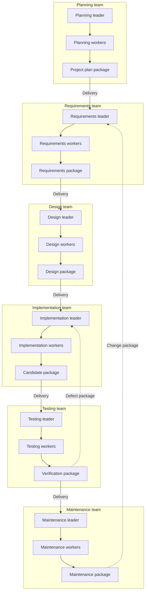

# Architecture and detailed design

## 1. Governing structure

The system has **six distinct SDLC teams**. Each team owns a leader, its workers, task history, model sessions and workspaces. A common runtime operates the machinery; it is not a shared conversational leader. The previous generic leader/worker pipeline is an internal team template only and must never be used as the global MAS architecture.

Every edge crossing a team box is a published `HandoffBundle` and recorded `Delivery`, including feedback. The drawing omits runtime routing and participant review for clarity. No edge grants direct agent-to-agent conversation. Other registered routes, such as Requirements to Testing for early test planning, obey exactly the same protocol. A worker type named reviewer can be implemented by reusable code, but its agent instance belongs to exactly one team.

## 2. Layers and dependency direction

Use Python 3.11 or later as the initial orchestration language. This is a design choice for readable teaching code, CLI integration and SQLite support, not a requirement that generated applications use Python. Start with one process and a bounded asynchronous scheduler, then use supervised child processes or containers for tool execution. A distributed queue, vector database and hosted control plane are unnecessary for the first release.

| Layer/module | Responsibility | Must not do |
|---|---|---|
| `cli` | Parse commands, show status, collect explicit decisions, export/import | Implement stage logic or call providers directly |
| `application` | Use cases: import, plan, run, review, resume, publish, deliver | Depend on a specific model SDK |
| `domain` | Typed contracts, state transitions, ownership, route/gate rules | Read credentials or launch commands |
| `runtime` | DAG validation, scheduler, attempts, leases, recovery, quotas | Invent product requirements or cross-team context |
| `teams/<team>` | Operation registry, prompts, required outputs and semantic reviews | Access the database or other teams' files |
| `ports` | Brain, CodingBackend, ResearchBackend, ProcessRunner interfaces | Include vendor response types in domain objects |
| `adapters` | Provider calls, native CLI events, local servers, auth mapping | Decide task completion without runtime validation |
| `artifacts` | Immutable payloads, imports, normalization, manifests, grants | Resolve arbitrary filesystem paths supplied by a model |
| `storage` | SQLite repositories, migrations, outbox, fenced transactions | Expose SQL to workers |
| `verification` | Deterministic schemas, source references, render/build/test evidence | Treat an LLM assessment as command execution evidence |

Dependency direction is adapters/CLI toward application and domain. Team operations depend on ports and domain contracts. Keep provider imports out of team modules. Use small interfaces, explicit request/result classes and dependency injection; avoid an elaborate autonomous-agent framework that obscures control flow.

## 3. Identity and information boundaries

An agent principal contains `project_id`, `cycle_id`, `team_id` and `agent_instance_id`. Bind it at launch from a registered task; model-provided team IDs cannot change this principal. A worker's task lineage can have several attempts and provider sessions, but cannot migrate to another team. Native session identity additionally binds backend profile, authenticated account reference and workspace lineage.

There are two separate stores: a privileged runtime control store and materialized team views. The former may know all project metadata. A model or coding process receives only its permitted view. Never mount the runtime database, project-wide artifact store, unrelated working trees or other teams' native-client history into an agent process.

The authorization rule for cross-team reads is:

1. The target team has an accepted delivery for this project and exact bundle digest.
2. The requested artifact reference occurs in that delivery's explicit `read_grants` and in the sealed bundle manifest.
3. The task declares that accepted delivery and artifact reference.
4. The runtime verifies the bytes against the reference digest before materializing them.

An artifact's `depends_on` entries describe provenance; they do **not** grant access to their contents. A bundle's manifest must explicitly flatten the required input closure. For example, Testing needs the exact requirements, design, candidate source and relevant build instructions; Implementation must explicitly forward the authorized versions in its outgoing manifest. Do not recursively fetch arbitrary provenance references. Missing required content produces a typed missing-input finding and a clarification package.

Forwarding is allowed only when the publisher owns the artifact or has a valid inbound read-and-forward authorization under project policy. Imported confidential material can have an explicit no-forward policy. The runtime checks this before sealing the manifest. Team-local drafts cannot become cross-team inputs until published. A participant may inspect all project outputs, but participant access does not automatically expose those outputs to every agent.

Use OS or container read isolation for compliant execution. A working directory, prompt rule or write-only sandbox is insufficient. The first supported execution profile must pass cross-team canary-read tests for normal file tools, native-client instructions/history and enabled external tools. If the installed profile cannot enforce these boundaries, return `capability_missing` and `needs_input` for the affected operation. A clearly labeled development mode is optional and must not pass the compliant lifecycle gate.

## 4. Artifact model and baselines

An `Artifact` describes one immutable revision and its payload. `ArtifactRef` is the tuple of ID, revision and SHA-256. Readable paths are package-relative labels, not authority. Revision numbers advance only within an artifact ID. Edits create new payloads and records; no in-place edits of published content.

Maintain separate mutable projections for lifecycle state: draft, reviewable, accepted, superseded or stale. Acceptance is a decision about exact revisions, not a property of a filename. A `HandoffBundle` seals an explicit artifact set, provenance, summary, findings and next actions. A `Delivery` binds that bundle to a target team and expected target baseline. Delivery receipt status is independent of engineering gate approval: accepting transport means it was validly received; it does not mean every requirement, test or release passed.

Baselines are runtime records of a team, cycle, accepted bundle digest and decision. `expected_target_baseline` implements compare-and-swap when delivering revisions. A new source baseline invalidates applicability of dependent evidence; it does not erase that evidence. Compute affected nodes from exact input references and semantic trace links, then request review when impact is uncertain. Never assume unchanged file contents imply unchanged requirement semantics.

Use archive payloads for source snapshots and testbench snapshots. Record archive digest and an inner file manifest with relative paths and hashes. Reject absolute paths, traversal, symlinks escaping the extraction root, executable import macros and decompression limits exceeded. The implementation integration workspace is private. Testing has its own immutable source copy plus its test overlay. Maintenance receives the released baseline closure and its evidence.

## 5. Stage leaders and operations

Each leader receives its scoped inbox and proposes a bounded task graph of registered operations. The runtime validates ownership, inputs, schemas, dependency acyclicity, concurrency, budgets and tool capabilities. The leader is responsible for engineering synthesis, while the runtime is responsible for admissibility and durable execution.

Operation names begin with their team ID, such as `requirements.define_acceptance`. The operation registry declares version, input kinds, output schema, required capabilities, permitted write paths and check recipes. Workers cannot invent operation names that become callable functions. Cross-team dependencies must be delivered artifact prerequisites; `Task.depends_on` is restricted to tasks inside the same team.

In a small project, a leader can perform more than one role inside its own team. Start with a maximum of two concurrent workers and no recursive worker spawning. A proposed extra worker or repair attempt consumes the same budget policy as other work. A semantic reviewer can reject poor content; its prose cannot override a failing deterministic contract or missing mandatory evidence.

## 6. Flexible document intake

The importer accepts Markdown/plain text, PDF and DOCX in release one. JSON is useful for normalized internal contracts, not mandatory user input. Store originals, compute hashes, detect type by content and apply configured size/page/archive limits before extraction. Save normalized text, source locations, tables where recoverable, extraction warnings and a completeness assessment. OCR is a declared optional capability; scanned or unreadable content must be surfaced.

Normalize in two steps: deterministic extraction followed by a scoped interpretation task. Preserve source IDs and page/paragraph locations in interpreted claims. Imported JSON receives the same validation as other sources. A PDF is never rejected merely because it is not JSON; an unreadable page can block only conclusions that depend on it. Contradictory source versions produce questions rather than silent precedence guessing.

Treat text inside imported files and websites as evidence, not runtime instructions. Tools, permissions and workflow state come from the operation registry and participant policy. If an imported document says to reveal credentials or read another team's files, retain it as untrusted content and refuse the operation.

## 7. Research and diagrams

Research has a retrieval phase and a synthesis phase. The former saves URL, title, publisher when available, retrieval time, source date when known, relevant excerpts/locators, query and limitations. The latter links claims to those sources and separates inference, assumption and simulated stakeholder opinion. Do not fabricate sources or measured demand. Simulated surveys store their generation method and synthetic responses. Multiple LLM personas are not independent customer samples.

The diagram service is shared code, but requests and outputs belong to the requesting team. A request names permitted source references, diagram type, engineering question and included requirement/component IDs. An agent recommends diagrams with reasons and estimated scope; a student can add another supported diagram or provide its editable source. Reject unsupported syntax/capability with a useful alternative instead of silently returning an unrelated image.

Use Mermaid for supported flow/state/sequence/component-style views and PlantUML where UML notation such as use cases is more suitable. Start with a small installed renderer set and register capabilities. Do not promise that Mermaid natively renders every UML diagram. Store editable source, renderer/version, command evidence and SVG/PNG when rendered. Validate syntax, referenced IDs, meaningful labels and consistency with the specification. A drawing can be a valid draft without a render, but must be labeled unrendered. The renderer runs in the constrained ProcessRunner and cannot retrieve arbitrary remote includes.

## 8. Execution and evidence

The process collector, not the LLM, records command execution. Commands are registered recipes or participant-approved argument arrays; no model-generated shell string is automatically privileged. Separate environment preparation from execution. Target-application builds/tests run without provider credentials and with bounded files, network, process count, time and disk access.

Test evidence ties together source snapshot, testbench snapshot, requirements/acceptance version, environment identity, command recipe, timestamps, exit code, assertion results and log references. A process exit of zero is insufficient when the report contains zero collected tests or contradicts mandatory case coverage. Preserve `not_run`, setup error, assertion failure, timeout and cancellation distinctly. See the Testing team and acceptance plan for release gates.

The handoff package may contain code examples and fixture results, but those are marked `origin: fixture` and cannot satisfy executed-test or release gates. This implementation handoff itself contains no implemented SDLC application and no live-provider validation.

## 9. Participant workflows

The first interface is a CLI with readable Markdown reports. A minimal participant path is: initialize project; configure a backend; run doctor; import brief; plan/run Planning; review exact outputs; proceed through each team; inspect test findings; deliver repairs; accept a local release; open a maintenance request. Each command displays its current team/baseline and whether the next action makes a billable request.

Support collaborative mode with decisions at stage gates and continuous mode with an explicit project policy. Continuous mode records policy decisions as such; it never records a human signature. Students can request diagrams, edit specifications, take over a task, import manual work and select an approved alternate backend. Imports create revisions and invalidate affected work through the same service paths as agent work.

When paused, show the cause, preserved artifacts, uncertain partial effects, reset time only if supplied reliably, and exact resume action. `resume --dry-run` performs no model call. A backend handover rebuilds context from accepted inputs and checkpoints; the new model does not inherit another team's hidden conversation.

## 10. Decisions and tradeoffs

| Decision | Reason | Revisit when |
|---|---|---|
| Six owned teams with artifact transport | Makes responsibilities teachable and handoffs auditable | Never weaken within this project's scope |
| Local CLI, SQLite and immutable files | Small deployable open-source core with durable recovery | Demonstrated multi-host coordination need |
| Provider-neutral ports; Codex default coding | Supports native tooling and model substitution | Adapter capability evidence changes |
| Exact references plus flexible import | Accepts human documents while enforcing machine boundaries | Add an importer without weakening contracts |
| Native client isolation is a release gate | Separate sessions alone do not enforce information boundaries | An OS profile proves equivalent protection |
| Explicit source/test snapshots | Keeps results reproducible across team changes | Optimize storage with safe deduplication |
| MCP as optional thin facade | MCP is a tool protocol, not login or scheduler | Core CLI/service paths are stable |

Open implementation choices are dependency versions, tested native-client versions, renderer distribution and one supported isolation launcher. Resolve them in M0/M1 with recorded spikes before claiming support. They must not alter the accepted interfaces or six-team boundary without a design change record.
